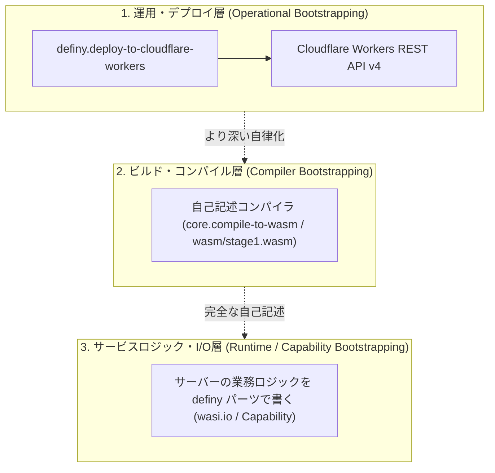

# definy のデプロイ・ブートストラップ構想 (Deployment Bootstrapping)

「definy が自分自身の次の世代をデプロイする」ための設計と到達状況。
今のデプロイ先は Cloudflare Workers で, デプロイそのものは definy で書いたパーツ
`definy.deploy-to-cloudflare-workers` が行う ([cloudflare-workers.md](cloudflare-workers.md))。

## ブートストラップの 3 階層

| 階層                      | 今の実装                                                                                     | ブートストラップ完成時の姿                                |
| :------------------------ | :------------------------------------------------------------------------------------------- | :-------------------------------------------------------- |
| 運用層 (Layer 1)          | `definy.deploy-to-cloudflare-workers` (definy で書いた, Cloudflare REST API v4 を呼ぶパーツ) | 達成済み ([cloudflare-workers.md](cloudflare-workers.md)) |
| ビルド層 (Layer 2)        | デプロイする Wasm は `core.compile-to-wasm`. definy 自身のビルドは `npm run build` (Void)    | definy 自身のビルドも definy のパーツで行う               |
| I/O・サーバー層 (Layer 3) | Cloudflare Workers (`worker/index.ts`, TypeScript)                                           | サーバーの業務ロジックを definy のパーツにする            |
| UI・エディタ層            | React 19 (`src/`, `pages/`)                                                                  | definy の UI 表現パーツ・ツリーレイアウト                 |

I/O の設計は [wasi-io.md](wasi-io.md) と [wasi-capability-io.md](wasi-capability-io.md),
コンパイラのセルフホストは [self-hosting.md](self-hosting.md) を参照。

## definy で書いた definy サーバー (`sample.self-hosted-definy-server`)

`seeds/sample.json` の `sample.self-hosted-definy-server` は HTTP リクエストを受け取ってレスポンスを返す純粋な関数パーツで,
中で `core.expression-to-source` (整形)・`core.optimize-expression` (定数畳み込み)・`core.type-check`・
`core.eval-ast`・`core.compile-to-wasm` を実際に呼び, その結果を HTML (`GET /`) と JSON (`GET /api/self-host`, `GET /healthz`) で返す。
`sample.deploy-self-hosted-definy-server` を評価すると Cloudflare Worker `self-definy` にデプロイされる。

## 以前の構想 (削除済み)

当初は fly.io の Machines API で子インスタンスを起動する計画で, Rust 製サーバーに `DeployService`
(`DeployInstance` など), `runner/` (wasmtime の汎用ランナー), `/deployments` 画面, サブドメインごとにパーツの
HTTP サーバーを動かすプレビュー (`PreviewService`) まで作っていたが, fly.io の撤去・TypeScript への移行・
デプロイを普通のパーツにする変更 (issue #733) で全て削除した。
