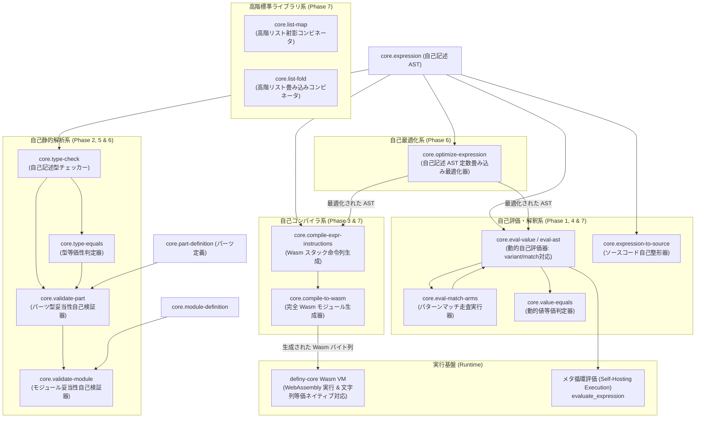

# definy のセルフホスト構想 (Self-Hosting)

definy を definy
自身の言語仕様・データ構造・評価器を用いて表現し、自己記述・自己検証可能にするための設計と実装仕様。

> [!NOTE]
> 本リポジトリは Rust + Deno から **TypeScript + React 19 + Void (Vite 8) + Cloudflare Workers** に移行済みです。
> 本ドキュメント内の Rust ツールチェイン（`cargo run -p definy-server`, `cargo test` など）に関する記述は、セルフホストおよび固定点達成に至るまでの**旧 Rust 実装（廃止済み）における歴史的経緯と仕様**を記録したものです。
> 現在の TypeScript 実装では `wasm/stage1.wasm` の実行パイプライン（`src/stage1_compiler.ts`）および Vitest（`src/stage1_conformance.test.ts`, `src/stage1_fixed_point.test.ts`）で検証されています。
> シードバンドルの再生成は `npm run build:seeds` (`scripts/generate_seed_bundle.ts`)、`stage1.wasm` の再生成と不動点検証は `npm run build:stage1` / `npm run check:stage1` (`scripts/regenerate_stage1.ts`) で実行可能です。

## 概要

definy
は、構文木（AST）、型システム、パーツやモジュールのメタデータ、そしてそれらの評価器・型チェッカー・コンパイラを
definy
の純粋なデータ構造および式（`Expression`）として自己記述できるセルフホスト環境を実現しています。

これにより、以下の利点が得られます：

1. **コンパイラ・評価器の完全自己完結**:
   外部言語（Rustなど）の変更なしに、definy 言語自体の新機能や最適化を definy
   内で記述・検証可能。
2. **決定論的かつコンテンツ指向の言語定義**: 式や型、モジュール構造自体が
   SHA-256 / Ed25519
   によるコンテンツ指向ハッシュで管理され、バージョンロックと不変性が保証される。
3. **安全なマクロ・メタプログラミング**:
   式をデータとして受け取り、式を返す関数を通常パーツとして安全に定義可能。
4. **自己ホスト WebAssembly 生成とエッジ配備**: definy 式から WebAssembly
   バイナリを直接生成でき、外部コンパイラなしでネイティブ/ブラウザおよび
   Cloudflare Workers エッジ上で即時実行可能（詳細は
   [自己記述コンパイラと Cloudflare Workers エッジ直結パイプライン](self-hosting-compiler-cloudflare-workers.md)
   を参照）。

### 実サービスとの接続状況

セルフホスト部品の実行テストは、Definy AST で記述した関数を Rust の
`definy-core` 実行基盤上で動かす検証です。Definy
サービス全体のブートストラップが完了したことを意味しません。

- `core.type-check`
  は、数値・文字列・真偽値、基本演算、変数、条件分岐、`let`、レコード構築（`record`）、フィールドアクセス（`record_get`）、直和型構築（`variant`）、パターンマッチ（`match`）、リスト式（`list`）、パーツ参照（`part_reference`）、型環境上の関数適用を扱います。
  宣言型を与える `core.type-check-against`
  は関数引数を型環境へ束縛して関数本体を検査します。 lambda
  はパーツ宣言型が要求する関数形に沿う位置か、関数型 parameter への Call
  引数でのみ受け入れます。 lambda を callee
  とする即時適用や、期待関数型のない位置の lambda は拒否します。
  `ModulePartEntry.part_type` はパーツ直下の宣言 metadata であり、式の中に置く型
  marker ではありません。 モジュール内の他パーツ参照（`part_reference`）は
  `type-env` 内の `parts`
  リスト（`core.part-type-env`）を参照して自己解決します。 `core.type-equals`
  は基本型・リスト型・関数型・record 型を再帰比較します。 union 型も variant
  の順序と optional payload 型を含めて比較し、reference 型は part hash
  で比較します。 record/union は定義順を含めて比較します。
- `PartType::Type` は自己ホスト `type-ast` の kind `type` として扱います。
  型定義パーツ内の型構築子（`type_list`, `type_function`, `type_record`,
  `type_union`）は、 `core.type-check-against` により再帰的に型検証されます。
  - **意味検査のセルフホスト化**: `core.list-contains-string`
    を用い、レコード型宣言内の重複フィールドキー（`core.type-check-type-record-fields`）
    およびユニオン型宣言内の重複バリアントタグ（`core.type-check-type-union-variants`）を検出して
    `invalid_type_declaration` エラーとして拒否します。
    また、ユニオン型の空バリアント集合も `invalid_type_declaration`
    として拒否し、 型引数に値式が混入した場合は `type_mismatch` で拒否します。
  - **型定義パーツ自体の相互参照**: 型宣言内の別パーツ参照（`PartReference`）は
    self-hosted AST の `part_reference` 式として変換され、
    モジュール型環境（`part-type-env`）を通じて参照先パーツが `type`
    であるかを解決・検証します。 これにより、`core.validate-module`
    において型パーツ同士の相互参照（レコード型やユニオン型による他型パーツの参照）
    を含むモジュール全体が一括して自己検証されます。 存在しないパーツ参照は
    `part_not_found`、通常の値パーツの型参照は `type_mismatch` で拒否されます。
- Connect-RPC の `SubmitEvent` は、`definy_core::self_hosted_type_check::check_module_commit`
  でコミットのパーツを `core.type-check-against` で検査してから保存します (UI の型エラー表示・
  seed の検証と同じ入口。下の「seed・UI のパーツ検査」を参照)。型環境は全モジュールの最新のパーツに
  コミットのパーツを重ねたものなので, 他のモジュールのパーツ参照も解決できます。
  パーツの型が変わらなければ式の変わったパーツだけを検査し (core の 1 パーツの編集なら 1 回の評価),
  型が変わればモジュールの全パーツを検査します。式の無いパーツ・`core.expression` で表せないパーツ
  (コンパイラ組み込み) はシステムアカウントのコミットでだけ受け入れます。
  型チェッカーが拒否した場合は `400` を返し, メッセージにパーツ名と型エラーを入れます。
  (以前は `core.validate-module` で全パーツを一括検証していましたが, 型パーツの展開ができず
  core のように大きなモジュールでは重すぎたため置き換えました)
- `core.validate-module` は、モジュール内のパーツリスト（`parts`）から
  `core.collect-part-type-env`
  によりモジュール型環境（`part-type-env`）を自動構築し、
  `core.validate-parts-in-env`
  を呼び出して全パーツを共通の型環境のもとで検査します。
  これにより、モジュール内の他パーツ参照（`part_reference`）や相互依存関係を含むパーツ群の
  セルフホスト一括妥当性検証が実現されています。

モジュール内パーツ参照の解決と、リスト・直和型構築・レコード・パターンマッチを含む式検査は
自己記述型チェッカー（`core.type-check` /
`core.type-check-against`）において検証・実証されています。
外部モジュールへのパーツ参照は, Rust 側で作る型環境 (全モジュールの最新のパーツ) を通じて解決しています。
`core.validate-module` 自体での外部モジュール参照解決や、型定義パーツ自体の自己ホスト循環参照解決などが今後の拡張対象です。

Content-addressed storage は同一 hash・同一 bytes の再保存を成功扱いし、hash
衝突や既存 bytes と異なる内容は拒否します。ModuleCommit
に同じ式が複数回現れても、投稿再試行が CAS 重複で失敗しません。

#### Lambda の配置規則

関数値を作る `function` 式は、期待する `PartType::Function`
に対応する場所だけで有効です。 これはパーツ定義直下の関数本体（curried function
は宣言された関数戻り値型に沿って束ねる）と、 関数型 parameter を受け取る Call
引数です。`((x) => ...)(arg)` のように lambda 自体を callee
にする即時適用は許可しません。関数の呼び出し先はパーツ参照または型環境上の変数にします。

`number` などのパーツ形状も式 node ではなく、パーツ定義の `part_type` metadata
に宣言します。 その宣言型が式 root の期待型になり、`core.validate-part`
が式全体を検査します。

### 今後の実装方針

以下の順で、通常の module 投稿を自己ホスト検証の対象へ広げます。各項目の先頭に到達状況を記します。

1. **[済] 型宣言の意味検査**: record field 名と union tag の重複、空 variant
   集合を `invalid_type_declaration` として拒否し、型パーツ同士の相互参照も解決します（Phase 9〜10）。
   型定義パーツ自体の再帰参照（循環）の規則は未決定です。
2. **[済] module type environment**: `core.collect-part-type-env` が
   `ModuleCommitEvent` の全パーツの hash と宣言型から環境を作り、
   `PartReference`・構築子・相互参照を解決します。
   サーバー・UI・seed の検証で使う型環境 (`definy_core::self_hosted_type_check::check_module_commit_parts`)
   は全モジュールの最新のパーツから作るので, 他のモジュールのパーツ参照 (ユーザーのモジュールから
   `core.list-contains-string` を呼ぶなど) も引数の型まで検査します (`commit_check_tests.rs` で確認)。
   definy 製の `core.validate-module` はモジュール内のパーツだけで環境を作るため外部モジュールを参照できませんが,
   こちらはテストでだけ使っています。型環境を作る部分を definy に移すのは今後の課題です。
3. **[済] 式検査の拡張**: list/record の構築と field access、union constructor、match
   の網羅性を `core.type-check` に追加済みです。UI の型エラー表示も自己ホスト型チェッカーを使います
   （[ui.md](ui.md) の「型エラー表示」を参照）。
4. **[済] bootstrap の固定**: core definitions を `seeds/*.json` として固定し、
   コミット済み seed が正規化済みであることを `seed_tests.rs` で検証します。
5. **[stage1 済] compiler bootstrap**: 対象言語を段階的に広げ、Rust stage0 から Definy
   compiler stage1 を作り、 stage1 が同一 compiler と test suite
   を再生成できるか比較します。definy 製コンパイラは評価器の適合テストを全て通り, 自分自身をコンパイルした stage1 の出力が
   stage0 と一致し, stage2 で不動点に達しています。下の「definy 製コンパイラの対応状況」を参照。
6. **service host 境界**: 最後に HTTP、database、署名、永続 event log を
   capability-limited host API として公開し、 サーバーの純粋な業務ロジックから
   Definy へ移します（WASI 0.3 スタイルの能力注入設計仕様は
   [wasi-capability-io.md](wasi-capability-io.md)
   を参照）。サービス自身のデプロイ・運用ブートストラップ構想（現在は Cloudflare Workers が対象）は
   [deployment-bootstrapping.md](deployment-bootstrapping.md)
   を参照。IO を持つサービス全体の移行は言語 runtime の拡張後です。

### セルフホスティング全体アーキテクチャ



---

## seed JSON が正本

ビルトインモジュール（`definy`, `core`, `std`, `wasi`, `sample`）のパーツ定義の正本は
`seeds/*.json` です。以前は `definy-server/src/builtin_*.rs`（約 17,000 行）の Rust コードで
AST を手組みし、そこから JSON を生成していましたが、このコードは削除しました。
本文中に出てくる `builtin_type_checker/record_ops.rs` などのファイル名は、その時点の実装場所を指す履歴です。

- 読み込み: `definy_server::seed::get_builtin_module_seeds()` が `include_str!` で埋め込んだ JSON を
  パースします。名前でのパーツ取得は `find_builtin_part(name)`（パーツ名は全モジュールで一意）。
- パーツ間参照のハッシュは、ビルトインシステムアカウント（`builtin_system_account_id()`）の
  モジュール ID から `derive_module_part_id` で計算済みです。テストも同じアカウントを使います。
- テスト: `self_hosting_tests` は `seed_part("type-check")` のように seed からパーツを取得して検証します。
  `seed_tests.rs` は、コミット済み seed が正規化済み（パースして整形し直した結果と一致）であることと、
  JSON Schema が最新であることを検証します。
- 編集方法（段階移行）: 旧 Rust 版では `cargo run -p definy-server -- --export-seeds seeds` で整形とスキーマ更新を行っていましたが、現在は未対応です。

## definy 製コンパイラの対応状況 (旧 Rust 版検証時)

definy 製の Wasm コンパイラ (`core.compile-to-wasm` / `core.compile-expr-instructions`) が, 旧 Rust 製コンパイラ
(`definy-core/src/wasm_emitter`, stage0) と比べてどこまでコンパイルできるかを測るテスト（旧 `definy-server/tests/self_hosted_compiler_coverage.rs`）が行われていました。

```sh
# 旧 Rust 版でのテストコマンド（現在は廃止済み）
cargo test -p definy-server --test self_hosted_compiler_coverage -- --nocapture
```

- `self_hosted_compiler_conformance`: 評価器の適合テスト (`conformance/eval_cases.json`) の各ケースを
  `self_hosted_wasm_compiler::compile_with_self_hosted_compiler` (Rust 製コンパイラへのフォールバックなし) で
  コンパイル・実行し, 期待値と比べます。通過数が `MIN_PASSING_CASES` を下回ると失敗するので,
  対応範囲を広げたらこの値を上げてください
- `self_hosted_compiler_self_compile_gaps`: definy 製コンパイラ自身のパーツが使う式の種類のうち,
  コンパイラが扱えないものを一覧します

### 適合テストの結果: 65 ケースすべてが期待値どおり

definy 製コンパイラは, Rust 製コンパイラ (stage0) と同じく評価器の適合テストの全ケースを通ります。

経過 (2026-10-17〜18): 測定開始時は 58 ケース中 15 (うち 2 つは偶然の一致), 真偽値・負の数を直して 25,
レコード・バリアントの誤った値を明示的な失敗にして 65 ケース中 28, 値の表現を下の形に作り直して 53,
関数・呼び出し・パーツ参照を入れて 65。

### stage1: definy 製コンパイラが自分自身をコンパイルできる

`self_hosted_compiler_stage1` (`definy-server/tests/self_hosted_compiler_coverage.rs`) で確かめています。

1. stage0: Rust 製コンパイラで動かした definy 製コンパイラで, 関数・クロージャ・呼び出し・レコード・文字列・
   `match` を含む式をコンパイルする
2. `core.compile-to-wasm(expr = その式の core.expression, parts = [])` という呼び出しを, definy 製コンパイラで
   コンパイルする。参照をたどってコンパイラ自身のパーツ (38 個) がすべて入り, 約 74KB の Wasm になる
3. その Wasm を実行して得たバイト列が 1 の出力と **1 バイトも違わず**, 実行すると同じ値になる

### stage2: 不動点に達している

`self_hosted_compiler_stage2` で確かめています。

1. stage1 = stage0 で `core.compile-to-wasm` への参照をコンパイルしたモジュール (`self_hosted_wasm_compiler::build_self_hosted_compiler_wasm`)。
   `evaluate` がコンパイラのクロージャを返す, 単独で動くコンパイラ (68,452 バイト)
2. stage1 を wasmtime で直接動かす (`definy_core::self_hosted_compiler_module::CompilerModule`)。入力の `core.expression` と
   `parts` を値の箱としてモジュールのメモリに書き (`alloc` をエクスポートしている), 関数表 (`table` をエクスポート) から
   クロージャを呼ぶと, 出力のバイト列 (`list<number>` の箱) が返る
3. stage1 でコンパイラ自身をコンパイルした stage2 が stage1 と **1 バイトも違わない** (不動点)
4. 適合テストの 65 個の式を stage0 と stage1 でコンパイルした結果も, すべて 1 バイトも違わない

所要時間 (debug ビルド, Apple Silicon): stage1 を作る (stage0) 約 13 秒, stage1 の読み込み (wasmtime のコンパイル) 0.6 秒,
stage1 でコンパイラ自身をコンパイル 0.16 秒, 適合テストの 65 個の式のコンパイルは stage0 で 125 秒, stage1 で 0.045 秒。

### stage1.wasm の再生成 (TypeScript 版)

TypeScript 移行後は、`scripts/regenerate_stage1.ts` を用いて `wasm/stage1.wasm` の再生成と不動点（fixed point）の自動検証を行えます。

```bash
# 再生成と既存バイナリとの一致検証 (CI / テスト向け)
npm run check:stage1

# 再生成して wasm/stage1.wasm に書き出し
npm run build:stage1
```

#### 再生成の手順と検証フロー

1. `seeds/*.json` のパーツ定義を読み込み、開発用システムアカウント鍵から導出した公開鍵を用いてパーツ ID のプレースホルダ (`{"$part": "core.compile-to-wasm"}`) を解決する。
2. `core.compile-to-wasm` への `PartReference` 式から、`collectReferencedParts` により参照される全 38 パーツを収集する。
3. 現在の `wasm/stage1.wasm` でコンパイルして `stage2` を生成する (68,452 バイト)。
4. 得られた `stage2` のバイナリを使って同じ式を再コンパイルし、`stage3` を生成する。
5. `stage2` と `stage3` が完全一致することを確認する（不動点検証）。`--check` 指定時は既存の `wasm/stage1.wasm` とも比較し、引数なし時は書き出す。
6. `src/stage1_fixed_point.test.ts` において、Vitest 経由でも不動点検証が自動テストされる。

#### 参照パーツの順序 (LIFO) とバイト一致

`src/stage1_compiler.ts` の `collectReferencedParts` では、参照パーツの探索キューから**末尾の要素を取り出す LIFO (後入れ先出し)** を採用しています。
旧 Rust 実装 (`definy-server/src/self_hosted_wasm_compiler.rs` の `referenced_parts_expression`) が `queue.pop()` で末尾から取り出していたため、同じ順序に揃えることで関数表（Wasm の table）のインデックス順や関数の配置順が一致し、既存の `wasm/stage1.wasm` (68,452 バイト) と 1 バイトの差異もなく完全一致させることができます（FIFO にするとサイズは同じでもインデックスがずれてバイト不一致になります）。

#### Node のスタックサイズ (`--stack-size=4000`)

コンパイラ自身のコード（38 パーツ）のような巨大な AST をコンパイルする際、`stage1.wasm` 内部の再帰呼び出しが深くなり、Node.js の既定コールスタックサイズ（約 984 KB）では `RangeError: Maximum call stack size exceeded` が発生します。
そのため、実行時には `node --stack-size=4000` を指定してスタックサイズを拡張する必要があります（コンパイル 1 回あたりの所要時間は約 0.3 秒）。

> [!WARNING]
> ブラウザや Cloudflare Workers の JavaScript / WebAssembly 実行環境においても既定のコールスタックサイズに同様の制約があるため、コンパイラ自身のように再帰が非常に深くなる大きな式を評価・コンパイルする場合はスタックオーバーフローが発生する可能性があります。

### 本番で stage1 の Wasm を使い回す道筋 (2026-10-18 の調査)

**速さ**: definy 製型チェッカーの呼び出し `core.type-check(1 + 2, 空の環境)` を例に測った (release ビルド, 結果はどちらも `ok(number)`)。

|                              | コンパイル | 実行 (wasmtime が出力をコンパイルする時間を含む) | 出力の大きさ |
| ---------------------------- | ---------- | ------------------------------------------------ | ------------ |
| Rust 製コンパイラ            | 7 ms       | 175 ms                                           | 208 KB       |
| definy 製コンパイラ (stage1) | 48 ms      | 100 ms                                           | 124 KB       |

stage1 はコンパイル自体は Rust 製より遅いが, 出力が小さい (参照された関数だけを出す) ので wasmtime のコンパイルが速く, 合計では同等以上。
stage0 (Rust 製の評価器で definy 製コンパイラを毎回コンパイルする今の `compile_with_self_hosted_compiler`) は 1 回数秒かかるので,
本番では使えない。どちらの場合も実行時間の大半は wasmtime による出力のコンパイルなので, 出力を content hash で
キャッシュする効果が大きい。

**使い回し方**:

- stage1 の Wasm は definy 製コンパイラのパーツ (seed の core) だけで決まる。パーツの content hash をキーにして
  1 回だけ作り, 保存して使い回す (サーバーの起動時に作る / CAS に置く / seed と一緒にビルド時に作る)。
  作り直したときは stage2 == stage1 (不動点) をテストで確かめる
- サーバー (wasmtime): `CompilerModule` を 1 つ持ち, コンパイルのたびにインスタンスを作る (メモリは解放しないので毎回新しく)
- ブラウザ (UI, wasm32): stage1 はブラウザの `WebAssembly` でそのまま動く。今の UI は definy 製型チェッカーを Rust 製コンパイラ
  (UI の Wasm に含まれる) でコンパイルしているので, stage1 に置き換えれば UI の Wasm から Rust 製コンパイラを外せる可能性がある。
  ただし `CompilerModule` は wasmtime 用なので, `js_sys::WebAssembly` 版が要る
- Cloudflare Workers: stage1 は静的な Wasm なので, デプロイ時にバンドルすれば Workers でもネイティブ (V8) に動かせる
  (実行時に作った Wasm ではないので制限に当たらない)。ただし stage1 の **出力** は実行時に作った Wasm なので,
  今と同じく wasmi か Dynamic Workers で動かす必要がある

**置き換えの状況** (2026-10-18):

1. `core.expression` で表せない式 (`BitAnd` などのビット演算, `Constructor`, 型の式) は definy 製コンパイラに渡せないので,
   Rust 製コンパイラにフォールバックしている (下の「サーバーの本番のコンパイルで stage1 を使う」)。言語側で `core.expression` に足せば外せる
2. HTTP アプリは stage1 の出力でも動くことを確かめた (下の「HTTP アプリとプレビュー」)
3. 文字列リテラルを 1 バイトずつ書く命令にしている。データセグメントにまとめたい (未着手)
4. 入口 `self_hosted_wasm_compiler::compile_expression_to_wasm` は stage1 を使うように切り替えた

### サーバーの本番のコンパイルで stage1 を使う

`definy-server/src/self_hosted_wasm_compiler.rs` に入っています。

- **キャッシュのキー**: `self_hosted_compiler_cache_key()` = `self-hosted-compiler-stage1:` + definy 製コンパイラのパーツ
  (`self_hosted_compiler_parts()`, `core.compile-to-wasm` から参照をたどった core のパーツ) の CBOR の `ContentHash`。
  seed の core を変えるとキーが変わる
- **プロセス内のキャッシュ**: `static STAGE1: OnceLock` に stage1 の Wasm と `CompilerModule` を 1 つだけ持つ。
  `self_hosted_compiler()` は無ければ作って待つ (debug で十数秒), `ready_self_hosted_compiler()` は待たずにできていれば返す
- **サーバーの起動時**: `start_server` の DB 初期化のタスクの後で `prepare_self_hosted_compiler(db)` を呼ぶ。
  DB の `contents` テーブルにキーで保存した stage1 があれば読み込み, 無ければ `spawn_blocking` で作って保存する
  (`contents` の他のレコードはバイト列の content hash がキーだが, このレコードだけは入力 (コンパイラのパーツ) の hash がキーのメモ)。
  読み込んだ stage1 は `15 + 27` を正しくコンパイルできるか確かめてから使い, 壊れていれば作り直す
- **入口** `compile_expression_to_wasm(expression, events)`: stage1 ができていれば使い, まだなら Rust 製コンパイラを使う
  (起動直後のリクエストを待たせない)。stage1 ができていても, 次の式は Rust 製コンパイラにフォールバックする
  (`checked_self_hosted_compiler_input`):
  - 式か, 式がたどって参照するパーツが `core.expression` で表せない
  - 参照するパーツが見つからないか式を持たない (definy 製コンパイラは unreachable にする)
  - `core.compile-expr-instructions` が個別に扱わないタグ (`type_number` など) を含む (`_` アームで unreachable になる)。
    扱うタグは seed の `core.compile-expr-instructions` の `match` から読むので, コンパイラに対応を足すと自動で広がる
- どちらを使ったかは `compile_expression_to_wasm_with(compiler, expression, events)` が `UsedCompiler` で返す
- 使っているのは `deploy_rpc` の `DeployCloudflare` (パーツをデプロイするとき)。DB のイベントも渡すので, パーツ参照を含む式もコンパイルできる
- テスト: `definy-server/tests/self_hosted_compiler_entry.rs` で, 適合テストの全 65 ケースが stage1 でコンパイルされ,
  実行結果が Rust 製コンパイラと期待値の両方に一致することを確かめている。フォールバックと DB への保存のテストもある

### HTTP アプリとプレビュー

`self_hosted_compiler_entry.rs` の `stage1_compiles_http_app` で, サンプルの `self-hosted-definy-server` のプレビューのハンドラ
(`/`, `/api/self-host`, `/healthz`, `/not-found`) を stage1 でコンパイルし, `execute_wasm_http_response` (wasmtime) と
wasmi のどちらでも Rust 製と同じステータス・ヘッダー・ボディになることを確かめた。クロージャの形 (`(env, args) -> i32`),
`table` のエクスポートが Rust 製と同じで, データを 1024 番地から置くので, ストリームの呼び出しが引数の置き場に使う 512 番地ともぶつからない。
出力は stage1 が約 278KB, Rust 製が約 529KB で stage1 の方が小さい (参照された関数だけを出すため)。

プレビューを stage1 に切り替える道筋 (今回は切り替えていない):

1. `definy_core::http_app::build_http_request_target_expression` でリクエストを適用した式を作る (切り出し済み)
2. `self_hosted_wasm_compiler::compile_http_request_to_wasm` で `definy_core::http_app::compile_http_request_to_wasm` の代わりに
   その式を `compile_expression_to_wasm(&target, events)` に渡す。フォールバックは入口と同じ
3. ハンドラが関数でない式のときに `evaluate_expression` (Rust 製コンパイラで 1 回コンパイルして実行) で関数かどうかを
   調べているので, ここも stage1 にするなら型 (`core.type-check`) で判定するか, stage1 でコンパイルして実行する
4. プレビューはリクエストのたびにコンパイルするので, リクエストを引数にした関数としてハンドラを 1 回だけコンパイルし,
   `CompilerModule` と同じようにメモリに書いたリクエストで呼ぶ形にすると, コンパイルと wasmtime のコンパイルをキャッシュできる

### 値の表現 (Rust 製コンパイラと同じ線形メモリの形)

すべての値を「線形メモリ上のタグ付きの箱」へのポインタ (i32) で表します。箱の形は Rust 製コンパイラ
(`definy-core/src/wasm_emitter/compiler.rs`) と実行結果の読み取り (`wasm_emitter::read_value_from_memory`) と同じです。

| タグ | 値                | 形                                                                   |
| ---- | ----------------- | -------------------------------------------------------------------- |
| 0    | 数値              | +8 に i64                                                            |
| 1    | 真偽値            | +8 に 1 バイト                                                       |
| 2    | 文字列            | +4 に長さ (バイト数), +8 から UTF-8 のバイト列                       |
| 3    | リスト            | +4 に要素数, +8 から要素の箱へのポインタ                             |
| 4    | レコード          | +4 にフィールド数, +8 から (キーの文字列の箱, 値の箱) のポインタの組 |
| 5    | 関数 (クロージャ) | +4 に関数表の番号, +8 に捕捉した変数の配列 (無ければ 0)              |
| 6    | バリアント        | +4 にタグの文字列の箱, +8 にペイロードの箱 (無ければ 0)              |

- メモリは確保するだけで解放しません (1 回の評価は短いので)。ヒープの先頭はグローバル変数 0 で, 確保は 8 バイト境界に揃え,
  足りなければ `memory.grow` します。確保したばかりのメモリは 0 なので, 数値の箱はタグを書かずに済みます
- 出力するモジュールは `evaluate` 関数 (結果の箱のポインタを返す), `memory`, 関数表 `table`, メモリを確保する `alloc` をエクスポートします (`cloudflare_workers.rs` が生成する JS のために, `evaluate` を `main` としてもエクスポート)。`table` と `alloc` は, 外から値を書いて関数を呼ぶため (`CompilerModule`)。
  `match` で真偽値のタグとして使う文字列 `"true"` `"false"` だけはデータセグメント (1024 番地) に置きます
- ランタイム関数 (メモリの確保, 数値・真偽値の箱詰め, 文字列の比較, 値の比較, `record_get`, リストと文字列の操作,
  `match` のタグとペイロードの取り出し) は Wasm の関数 1〜14 として毎回モジュールに含めます。本体は `core.wasm-runtime-functions`
  に固定のバイト列として入っています。組み立てるスクリプトは `scripts/wasm_runtime_functions.py`
  (`python3 scripts/wasm_runtime_functions.py seeds/core.json` で seed のこのパーツだけを書き換える)
- 文字列のリテラル・レコードのキー・バリアントのタグは, 実行時に箱を確保して 1 バイトずつ書きます。
  データセグメントにまとめれば命令列を小さくできますが, コンパイラ全体に「どこに何を置いたか」の状態を引き回す必要があるので後回し
- ローカル変数は i32 を 512 個宣言し, 式の深さ (`depth`) ごとに 1 つずつ一時領域として使います。`let` と `match` のアームで
  束縛した変数もその深さのローカル変数に置き, 変数 ID からローカル変数への対応 (`env`) を `core.compile-expr-instructions` に渡します。
  兄弟の式は同じ深さを使い回せます (先に評価した値はスタックに積まれていて, ローカル変数には残っていないため)
- 値がすべて箱に入っていて実行時にタグで種類が分かるので, 式全体の型をコンパイル時に求める必要はありません
- 未対応の式と, どのアームにも一致しない `match` は `unreachable` にします

### 関数・呼び出し・パーツ参照

Rust 製コンパイラ (`wasm_emitter/function_ops.rs`) と同じ形です。

- 関数は Wasm の関数 (型 `(env_ptr, args_ptr) -> i32`) にし, 関数表 (table 0) に並べます。Wasm の関数番号は
  15 (ランタイム関数の後ろ) から, 関数表の番号は 0 から
- 関数の値はクロージャの箱 (タグ 5)。関数の式を評価すると, 本体の自由変数 (`core.free-variables`) を環境の配列に詰めて箱を作る。
  関数の本体は, 引数の配列 (第 2 引数) からパラメーターを, 環境の配列 (第 1 引数) から捕捉した変数をローカル変数に読み込んでから始まる
- 呼び出しは, 関数の値と引数の配列 (引数は書いた順) を作って `call_indirect`
- **関数の番号の付け方**: definy には状態が無いので, コンパイルしながら関数を集めて番号を振ることができない。そこで
  - `core.collect-functions` で式の中の関数の式を前順 (自身が先, 次に子を `core.expression-children` の順) に並べ, その位置を番号にする
  - `core.compile-expr-instructions` は引数 `fn_base` (その式の中で最初の関数の番号) を受け取り, 子をコンパイルするときは
    前の兄弟に含まれる関数の数 (`core.count-functions`) を足して渡す。こうすると集めたときと同じ番号になる
- **パーツ参照**: Rust 側 (`self_hosted_wasm_compiler::compile_with_self_hosted_compiler`) が, 式から参照をたどって集めたパーツを
  `parts: list<{ id, expression }>` として `core.compile-to-wasm` に渡す。関数表には, 式の中の関数の後ろに各パーツの式の中の関数を続ける
  (`core.compile-assign-part-bases` で各パーツの最初の番号を求める)。
  関数のパーツへの参照は, その番号のクロージャ (環境なし) になる。関数でないパーツへの参照は, 参照した場所でパーツの式をコンパイルする
  (パーツの中の関数の番号はパーツの最初の番号から数えるので, どこでコンパイルしても同じ)。インライン化中のパーツを再び参照したら `unreachable`
- 式を持たないパーツ (コンパイラ組み込み) や `core.expression` で表せないパーツは渡さないので, 参照すると `unreachable`
- 引数は名前ではなく書いた順に渡す (Rust 製と同じ)

### Rust 製コンパイラの修正: 静的データが 64KB を超えるとヒープが上書きしていた

Rust 製コンパイラはリテラル (数値・真偽値・文字列) を 1024 番地からの静的データに置き, ヒープを常に 65536 番地から始めていました。
静的データが 64KB を超えると, ヒープの確保が静的データを上書きし, 定数が別の値に化けていました
(definy 製コンパイラにコンパイラ自身の式を渡したときに `unsigned-leb128` の結果がおかしくなって見つかった)。
`module_builder::assemble_wasm_module` でヒープを静的データの後ろから始め, メモリの初期ページ数も足りるようにしました
(`test_large_static_data_is_not_overwritten_by_heap`)。

### 次に進める順番の案

1. ~~stage1 の Wasm を content hash をキーにキャッシュし, `compile_expression_to_wasm` で stage0 の代わりに使う~~ (済み: 上の「サーバーの本番のコンパイルで stage1 を使う」)。次はプレビュー (上の「HTTP アプリとプレビュー」)
2. definy 製型チェッカーの実行 (サーバー・UI) を stage1 でコンパイルするように切り替え, Rust 製コンパイラの出番を減らす
3. 文字列リテラルなどをデータセグメントにまとめて, 出力を小さくする

## セルフホストのロードマップと到達状況

- [x] **Phase 1: 完全動的値評価器 (Self-Evaluating Interpreter)**
  - 動的値型 `core.value`、変数環境型 `core.env`、環境探索
    `core.env-lookup`、環境拡張 `core.env-extend`
  - 完全動的値自己評価器 `core.eval-value`: `expression -> env -> value`
- [x] **Phase 2: 自己記述型チェッカー (Self-Hosted Type Checker)**
  - 型エラー型 `core.type-error`、型検査結果型 `core.type-result`、型環境
    `core.type-env`
  - 型等価性判定 `core.type-equals`
  - 静的型検査器 `core.type-check`: `expression -> type-env -> type-result`
  - `core.type-check-against` による宣言型ベースの lambda 検査と inline type
    declaration の kind 検証
- [x] **Phase 3: 自己ホスト WebAssembly コンパイラ (Self-Hosted Wasm Compiler)**
  - 式スタック命令列コンパイラ `core.compile-expr-instructions`:
    `expression -> list<number>`
  - 完全 WebAssembly バイナリ生成器 `core.compile-to-wasm`:
    `expression -> list<number>`
  - definy の Wasm VM による即時実行・検証を実証完了
- [x] **Phase 4: 自己記述フォーマッター・メタ循環評価 (Self-Hosted Formatter &
      Meta-Circular Execution)**
  - 自己記述コード整形器 `core.expression-to-source`: `expression -> string`
  - 構文拡張: `let`, `not`, `and`, `or` の完全自己評価 (`core.eval-value`) &
    型検査 (`core.type-check`)
- [x] **Phase 5: パーツ自己検証器 & 完全自己ホストコンパイル実証
      (Self-Validation & End-to-End Compiler Execution)**
  - パーツ妥当性自己検証器 `core.validate-part`: `part-definition -> boolean`
  - Wasm 命令列コンパイラ `core.compile-expr-instructions` の論理演算（`not`,
    `and`, `or`）対応
  - 自己記述コンパイラ `core.compile-to-wasm` による Wasm
    生成・即時実行の実証完了
  - 汎用自己評価器 `core.eval-value`、自己型チェッカー
    `core.type-check`、自己バリデータ `core.validate-part` のメタ循環実証完了
- [x] **Phase 6: 自己記述 AST 最適化器 & モジュール全体自己検証 (Self-Hosted
      Optimizer & Module Validation)**
  - 自己記述 AST 最適化器 `core.optimize-expression`: `expression -> expression`
    - 定数畳み込み（Constant Folding: 算術演算、論理否定、条件分岐の枝刈り）
    - 最適化された AST からの Wasm 生成 & 即時実行実証完了
  - モジュール妥当性自己検証器 `core.validate-module`:
    `module-definition -> boolean`
    - モジュール名検証（非空文字チェック）および全パーツの型妥当性の網羅検証実証完了
- [x] **Phase 7: 直和型・パターンマッチ自己評価 & 動的等価判定 &
      高階コレクションコンビネータ (Self-Hosted ADT Pattern Matching &
      Collections)**
  - Wasm コンパイラでのディープ文字列等価比較ネイティブ対応（`Expression::Equal`
    / `Expression::NotEqual` で Tag 2: String のバイト列比較ディスパッチ）
  - 動的値等価性自己判定器 `core.value-equals`: `value -> value -> boolean`
  - 直和型構築 `variant` 式の自己解釈実行（`core.eval-value`）
  - パターンマッチ `match` 式の完全自己解釈実行（`core.eval-match-arms`,
    `core.eval-match-arms-inner`
    による先頭からの線形マッチと拡張環境上での本体評価）
  - 高階リスト操作コンビネータ `core.list-map`:
    `(a -> b) -> list<a> -> list<b>`、`core.list-fold`:
    `(b -> a -> b) -> b -> list<a> -> b`
  - メタ循環パターンマッチ実行および高階リスト処理の実行実証完了
- [x] **Phase 8: レコード構築・フィールドアクセスの自己ホスト型検査 &
      自己評価拡張 (Self-Hosted Record & Field Access)**
  - 型エラー型 `core.type-error` に `not_a_record`, `field_not_found` を追加
  - レコードフィールド型探索 `core.record-field-type-lookup`
    およびレコード型検査器 `core.type-check-record-fields` を新設
  - 静的型検査器 `core.type-check` に `record`（レコードリテラル）および
    `record_get`（フィールドアクセス）の型検査アームを追加
  - 動的値型 `core.value` に
    `record(value: list<{ key: string, value: value }>)` を追加
  - 動的フィールド値探索 `core.record-field-lookup` およびレコード動的評価器
    `core.eval-record-fields` を新設
  - 完全動的値評価器 `core.eval-value` に `record` リテラルの評価および
    `record_get` によるフィールド値アクセスの評価アームを追加
  - 動的等価判定器 `core.value-equals` に `core.value-equals-record-fields`
    を追加し、動的レコード同士の順序依存・キー/値再帰等価比較に対応
  - Wasm コンパイラ `emit_match_arms` におけるワイルドカード `_`
    の無条件マッチ対応
  - レコード式の型検査・動的自己評価・動的等価判定およびパーツ妥当性検証（`core.validate-part`）のメタ循環実証完了
- [x] **Phase 9: 直和型（Union）・パターンマッチ（Match）の自己ホスト型検査 &
      網羅性検証 (Self-Hosted Union Variants & Pattern Match Type Checking)**
  - 型エラー型 `core.type-error` に `not_a_union`, `variant_not_found`,
    `non_exhaustive_match` を追加
  - 直和型探索・検証パーツ群（`seeds/core.json`、旧 `builtin_type_checker/union_lookup.rs`）を新設
    - `core.union-variant-type-lookup`:
      直和型から指定タグのペイロード型を線形探索（引数なし variant は `{}`
      レコード型として統一）
    - `core.find-tag-in-arms`: マッチアーム一覧に対象タグが含まれるかを線形探索
    - `core.check-union-exhaustiveness`:
      直和型の全タグがマッチアームに網羅されているかを検証し、欠落時に
      `non_exhaustive_match` を返却
    - `core.type-assignable-union-variants`:
      直和型の双対的幅サブタイピング（$Actual \subseteq Expected$）を再帰検証
  - パターンマッチ型検査パーツ群（`seeds/core.json`、旧 `builtin_type_checker/union_check.rs`）を新設
    - `core.type-check-match-arms-inner`（現在は `core.type-check-match-arms-infer` /
      `core.type-check-match-arms-skipped` の 2 段階に置き換え。Phase 2 の 6 を参照）:
      各アームの環境拡張、本体型検査、戻り値型一致検証（初出アーム型との
      `type-assignable`）、全走査完了後の網羅性検査の呼び出し
    - `core.type-check-match-arms`: パターンマッチ型検査のエントリーポイント
  - 静的型検査器 `core.type-check` に `variant`（直和型値の生成・型推論）および
    `match`（パターンマッチ式）の型検査アームを追加
  - 型代入適合性検査器 `core.type-assignable`
    に直和型同士の部分型関係（サブタイピング）検証を追加
  - 1000行ルールに基づき `union_lookup.rs` と `union_check.rs` に責務を分離
  - 単体バリアント推論、双対的サブタイピング代入、全アーム型一致、網羅性欠落エラー検出、未知バリアントエラー検出のメタ循環実証完了
- [x] **Phase 10: リスト式（List Literal）の自己ホスト型検査 &
      共変サブタイピング (Self-Hosted List Type Checking & Covariant
      Subtyping)**
  - 型エラー型 `core.type-error` に `cannot_infer_empty_list` を追加
  - リスト型検査パーツ群（`seeds/core.json`、旧 `builtin_type_checker/list_ops.rs`）を新設
    - `core.type-check-list-items`:
      リストリテラルの各要素を期待される要素型に対して再帰検査し、全要素適合時に
      `ok(list({ item_type }))` を返却
    - `core.type-check-list`: リストリテラルの要素型を推論（空リスト時は
      `cannot_infer_empty_list`
      を返し、要素がある場合は先頭要素から型を推論して残りを検証）
  - 静的型検査器 `core.type-check` に `list` 式の型検査アームを追加
  - 期待型照合検査器 `core.type-check-against` に `list`
    式アームを追加し、空リスト `[]` に対する期待型適合（双方向型推論）に対応
  - 型代入適合性検査器 `core.type-assignable`
    にリスト型の共変サブタイピング（$ActualItem \le ExpectedItem \implies list<ActualItem> \le list<ExpectedItem>$）を追加
  - 数値・文字列リストの型推論、空リスト推論拒否、期待型付き空リスト検査、異種要素不一致エラー検出、レコードリストの共変代入適合性のメタ循環実証完了
- [x] **Phase 11: Seed データの分離・固定化と JSON Schema によるブートストラップ
      (Self-Hosted Seed Decoupling & Schema Validation)**
  - Rust コード内の手組み AST への依存を解消し、Git / GitHub
    でバージョン管理しやすいテキスト形式の静的定義データ（`seeds/*.json`）を導入
  - モジュール Seed 型 `definy_event::event::ModuleSeed` を新設し、`schemars`
    による Draft-07 準拠の JSON
    Schema（`seeds/schemas/module-seed.schema.json`）を自動生成
  - `core.json`, `std.json`, `wasi.json`, `sample.json` を独立した Seed JSON
    ファイルとして書き出し、エディタ（VSCode）での `$schema`
    によるリアルタイム型補完・検証環境を整備
  - `builtin_migration.rs` を約 870 行から約 150
    行に大幅スリム化し、パーツ生成責務を
    `builtin_core_parts.rs`、`builtin_sample_parts.rs`、`seed.rs`
    に分離（1000行制限ルールを遵守）
  - `seed_tests.rs`
    テストスイートにより、スキーマ適合性、完全デシリアライズ性、および自己記述型チェッカー（`core.validate-module`）によるモジュール型妥当性検証の自動テスト実証完了
  - **seed の正本化**: Rust の AST 構築コードを削除し、`seeds/*.json` を正本とした
    （[seed JSON が正本](#seed-json-が正本) を参照）。`seed_tests.rs` はディスクへ書き込まず、
    コミット済み seed が正規化済みであることだけを検証する（`find_stale_seed_files`）。

---

## セルフホスト用ビルトインパーツ (`core` モジュール)

### Phase 1: 動的値・環境と完全評価器

#### 1. 動的値型: `core.value`

ランタイム実行時の動的値を表現する直和型（Union Type）。

- `number(value: number)`: 数値
- `string(value: string)`: 文字列
- `boolean(value: boolean)`: 真偽値
- `list(value: list<value>)`: リスト値
- `closure({ parameter_id: number, body: expression, captured_env: env })`:
  レキシカルスコープを保持する関数クロージャ
- `variant({ tag: string, payload: value })`: タグ付き直和型値
- `unit`: 空値

#### 2. 変数環境型 & 補助関数: `core.env`, `core.env-lookup`, `core.env-extend`

- `core.env`: `list<{ variable_id: number, value: value }>`
- `core.env-lookup`:
  `env -> variable_id -> value`（環境の末尾から最新の束縛を線形探索）
- `core.env-extend`:
  `env -> variable_id -> value -> env`（環境の末尾に新しい変数値を追加）

#### 3. 完全動的値評価器: `core.eval-value`

```definy
eval-value: expression -> env -> value
```

- リテラル（数値・文字列・真偽値）、算術演算（`add`, `subtract`, `multiply`,
  `divide`, `remainder`）、等価比較（`equal`）、小なり比較（`less_than`）
- レキシカルスコープ環境による変数解決（`variable`）
- 条件分岐（Bool に対する `match`。対象が `boolean` のときタグ `"true"` / `"false"` のアームを選ぶ）
- 関数定義時における環境キャプチャ（クロージャ生成）
- 関数呼び出し（`call`）時におけるキャプチャ環境の復元と引数束縛

---

### Phase 2: 自己記述型チェッカー

#### 1. 型エラー型 & 結果型: `core.type-error`, `core.type-result`

- `core.type-error`:
  - `type_mismatch({ expected: type-ast, actual: type-ast })`: 型の不一致
  - `undefined_variable({ variable_id: number })`: 未定義の変数参照
  - `part_not_found({ part_definition_event_hash: string })`:
    モジュール型環境にパーツ定義が存在しない
  - `cannot_infer_empty_list`: 期待型のない空リストの型推論失敗
  - `unknown_error`: 未知のエラー
- `core.type-result`: `ok(type-ast) | error(type-error)`

#### 2. 型環境型: `core.type-env`, `core.part-type-env`, `core.type-env-lookup`, `core.type-env-extend`, `core.part-type-lookup`, `core.type-env-lookup-part`

- `core.part-type-env`:
  `list<{ part_definition_event_hash: string, part_type: type-ast }>`
  - モジュール内のパーツ定義ハッシュと宣言型の対応関係を保持する環境。
- `core.type-env`:
  `{ variables: list<{ variable_id: number, var_type: type-ast }>, parts: list<{ part_definition_event_hash: string, part_type: type-ast }> }`
  - ローカル変数の静的スコープ束縛とモジュール内パーツ宣言型を統合した二層の型環境。
- `core.type-env-lookup`: `type-env -> number -> type-result`（変数の型を検索）
- `core.type-env-extend`:
  `type-env -> number -> type-ast -> type-env`（変数の型束縛を追加）
- `core.part-type-lookup`:
  `part-type-env -> string -> type-result`（パーツ宣言型を検索）
- `core.type-env-lookup-part`:
  `type-env -> string -> type-result`（統合環境からパーツ宣言型を検索）

#### 3. 型等価性判定: `core.type-equals`

```definy
type-equals: type-ast -> type-ast -> boolean
```

2つの `type-ast` が同一の型であるかを再帰的に判定。

#### 4. 静的型チェッカー: `core.type-check`

```definy
type-check: expression -> type-env -> type-result
```

definy の式 AST
を静的に走査し、型安全性を検証して最終的な型または詳細な型エラーを返却。

#### 5. 期待型に対する検査: `core.type-check-against`

```definy
type-check-against: expression -> type-env -> type-ast -> type-result
```

式・型環境に加えて期待型を受け取る bidirectional checker です。`function`
式では期待型の parameter を環境へ束縛して body を return type
に照らして検査します。`call` 式は環境から 関数型を得て、引数型と parameter
の一致を確認してから return type を返します。 引数型注釈を持たない lambda
の型は、宣言された期待関数型から決めます。

#### 6. seed・UI のパーツ検査 (`definy_core::self_hosted_type_check`)

UI の型エラー表示と seed の検証 (`definy-server/tests/self_hosted_type_check_tests.rs`) は
`definy_core::self_hosted_type_check::check_parts` で `core.type-check-against` を呼びます。
Rust の `Expression` から `core.expression` の値への変換は `definy_core::self_hosted_ast` です。
seed のパーツはコンパイラ組み込み (`core.number-literal`) 以外すべて型エラーなしで通ります。

- **まとめて実行**: 型環境を `let env = ... in [check(a), check(b), ...]` で 1 回だけ作り, 8 パーツずつ
  1 つの式にして Wasm にコンパイル・実行します。まとめた実行が失敗したら 1 パーツずつやり直し,
  どのパーツで失敗したか (`CheckerFailed`) を分かるようにします。
- **型パーツの展開**: 型パーツは `reference({ part_hash })` 型で表します。型環境には型パーツの
  宣言した型を `{hash}#definition` のキーでも入れ, `core.type-resolve` がそれを使って中身の型に展開します。
  `call`・`record_get`・`match` の対象, `type-check-against` の期待型は展開してから見ます。
  `core.type-assignable` 系は `env` 引数を取り, 片方だけが `reference` のときは展開して比べます。
  両方 `reference` ならハッシュが同じときだけ代入できます (名前的型付け)。
- **双方向検査**: `type-check-against` は `variant`・`match`・`let`・`list_append`・`list_concat`・
  `list_get`・`record` も期待型で検査します (`type-check-record-fields-against` など)。
  空リストや `none` を期待型から決められるのはこのためです。
- **match の推論は 2 段階**: `core.type-check-match-arms-infer` が推論できるアームから型を求め
  (アームごとに広い方の型を採る), 推論できなかったアーム (空リストなど) を
  `core.type-check-match-arms-skipped` がその型で検査します。
  `_` アームは何も束縛せず, `find-tag-in-arms` ではすべてのタグに一致します。
  対象の型に無いタグでペイロードを束縛しないアーム (`variable_id` が負) は到達しないアームとして許します
  (`core.match-arm-env`)。
- **演算子**: 比較 (`<=` など)・文字列 (`string_concat` など)・リスト (`list_length` など) の式も
  `core.expression` のバリアントと `core.type-check-binary` で検査します。

ノウハウ:

- Wasm の線形メモリはバンプアロケータ (global 0) で確保します。初期 16 ページを超えると
  `out of bounds memory access` になるため, ヒープポインタを進めるたびに
  `emit_ensure_heap_capacity` で足りない分を `memory.grow` します。ポインタを進める前に書き込む
  操作があるので 1MB の余裕を持たせています。
- 関数のローカル変数の数は `next_local_idx + 64` で宣言します (以前の `count_locals` との二重計上で
  大きな式が `too many locals` になっていた)。
- 1 回の検査はネイティブの release で 400ms ほどで, 大半が型チェッカー本体のコンパイルです。
  型チェッカーを 1 度だけコンパイルし, 引数の値を線形メモリに書き込んで関数として呼び出せば速くなりますが,
  値をメモリへ書き込む処理を 3 つの実行環境 (wasmtime・ブラウザ・wasmi) に用意する必要があるため未着手です。

---

### Phase 3: 自己ホスト WebAssembly コンパイラ

#### 1. スタックマシン命令列コンパイラ: `core.compile-expr-instructions`

```definy
compile-expr-instructions: expression -> list<number>
```

式 AST を WebAssembly
のバイトコード命令列（`list<number>`）へ再帰的に変換します。

- `number`: `i64.const` (`0x42`) + LEB128 エンコードバイト列
- `add`: 左辺命令列 + 右辺命令列 + `i64.add` (`0x7c`)
- `subtract`: 左辺命令列 + 右辺命令列 + `i64.sub` (`0x7d`)
- `multiply`: 左辺命令列 + 右辺命令列 + `i64.mul` (`0x7e`)
- `divide`: 左辺命令列 + 右辺命令列 + `i64.div_s` (`0x7f`)
- `equal`: 左辺命令列 + 右辺命令列 + `i64.eq` (`0x51`)
- `less_than`: 左辺命令列 + 右辺命令列 + `i64.lt_s` (`0x53`)

#### 2. 完全 Wasm モジュール生成器: `core.compile-to-wasm`

```definy
compile-to-wasm: expression -> list<number>
```

スタック命令列をラップし、完全で実行可能な WebAssembly
バイナリ（`list<number>`）を組み立てて出力します。

出力されるバイナリ構造：

1. **Magic Header** (8 bytes): `\0asm` (`[0x00, 0x61, 0x73, 0x6d]`) + Version 1
   (`[0x01, 0x00, 0x00, 0x00]`)
2. **Type Section** (Section 1): 1 つの関数シグネチャ `() -> i64`
3. **Function Section** (Section 3): Type 0 を参照する 1 つの関数
4. **Export Section** (Section 7): 関数 0 を `"main"` としてエクスポート
5. **Code Section** (Section 10): ローカル変数定義（0個）+
   コンパイルされたスタック命令列 + `end` (`0x0b`)

生成されたバイト列は、definy の Wasm VM およびブラウザの
`WebAssembly.instantiate` で即座にロード・実行できます。

---

### Phase 4: 自己記述フォーマッターとメタ循環評価

#### 1. 式 AST コード整形器: `core.expression-to-source`

```definy
expression-to-source: expression -> string
```

definy の式
AST（`core.expression`）を受け取り、対応するソースコード文字列（`string`）を再帰的に組み立てて出力する純粋な
definy パーツ。

- `number`: `"<number>"`
- `string`: 文字列リテラルそのもの
- `boolean`: `"true"` または `"false"`
- `add`, `subtract`, `multiply`, `divide`, `remainder`:
  括弧と二項演算子記号付き文字列（例: `"((a + b) * c)"`）
- `equal`, `less_than`: 比較式文字列（例: `"(a < b)"`）
- `and`, `or`: 論理結合文字列（例: `"(a && b)"`）
- `not`: 単項否定文字列（例: `"!a"`）
- `match`: `"match (target) { ... }"`
- `call`: `"fn(arg)"`
- `variable`: 変数参照文字列

#### 2. メタ循環評価 (Meta-Circular Evaluation) 実証

definy 式として記述された評価器・フォーマッターパーツは、definy の WebAssembly
実行基盤（`definy-core`）上で直接実行・検証されています。

- `test_self_hosted_meta_circular_eval_ast_execution`: `core.eval-ast`
  パーツに多項式 AST `(100 - (10 * 3)) + (50 / 2)` を与えて実行し、自己評価結果
  `95` を実証。
- `test_self_hosted_expression_to_source_execution`: `core.expression-to-source`
  パーツに `10 + 20` の AST を与えて実行し、自己整形結果
  `"((<number> + <number>))"` を実証。

---

### Phase 5: パーツ自己検証器 & 完全自己ホストコンパイル実証

#### 1. パーツ妥当性自己検証器: `core.validate-part`

```definy
validate-part: part-definition -> boolean
```

definy
のパーツ定義メタデータ（`core.part-definition`）を受け取り、式（`expression`）を
宣言型（`part_type`）に照らして `core.type-check-against`
で検証する自己完結バリデータ。

- 入力パーツの式を空の初期型環境（`[]`）と宣言型で検査
- 関数式は宣言型から引数型を得て、関数本体の変数環境へ束縛
- 型不一致または型エラーの場合は `false` を返却

---

### Phase 6: 自己記述 AST 最適化器 & モジュール全体自己検証

#### 1. 自己記述 AST 最適化器: `core.optimize-expression`

```definy
optimize-expression: expression -> expression
```

definy の式
AST（`core.expression`）を受け取り、定数同士の計算を事前に計算して置き換える「定数畳み込み（Constant
Folding）」および不要な分岐の枝刈り（Dead Code
Elimination）を行う純粋な最適化パーツ。

- `add(number(a), number(b))` => `number(a + b)`
- `subtract(number(a), number(b))` => `number(a - b)`
- `multiply(number(a), number(b))` => `number(a * b)`
- `not(boolean(b))` => `boolean(!b)`
- `match({ target: boolean(true), arms })` => `optimize(true アームの本体)`
- `match({ target: boolean(false), arms })` => `optimize(false アームの本体)`

最適化された AST は、`core.compile-to-wasm`
を介して単一の定数命令（`i64.const 42`）などに凝縮され、WebAssembly
バイトコードサイズの縮小と実行高速化をセルフホスト自身で実現します。

#### 2. モジュール妥当性自己検証器: `core.validate-module`

```definy
collect-part-type-env-inner: list<part-definition> -> list<{ part_definition_event_hash: string, part_type: type-ast }> -> number -> list<{ part_definition_event_hash: string, part_type: type-ast }>
collect-part-type-env: list<part-definition> -> list<{ part_definition_event_hash: string, part_type: type-ast }>
validate-part-in-env: part-definition -> type-env -> boolean
validate-parts-in-env: list<part-definition> -> type-env -> number -> boolean
validate-module: module-definition -> boolean
```

モジュール定義（`core.module-definition`）を受け取り、以下の手順でモジュール全体を自己一括検証します：

1. **モジュール名検証**:
   モジュール名が非空文字（`string-length > 0`）であることを確認。
2. **モジュール型環境の自動収集 (`core.collect-part-type-env`)**:
   パーツ定義リスト（`parts`）の各要素から `part_definition_event_hash` と
   `part_type` を抽出し、モジュール型環境
   `list<{ part_definition_event_hash, part_type }>` を構築。
3. **型環境構築と全パーツ一括検査 (`core.validate-parts-in-env`)**:
   収集したパーツ型環境を持つ
   `type-env`（`{ variables: [], parts: collected_parts }`）を生成し、全パーツを
   `core.validate-part-in-env`
   で順次検証。モジュール内のパーツ参照（`part_reference`）や相互呼び出しが共通の型環境を通じて自己解決され、すべてのパーツが宣言型に適合する場合に
   `true` を返却します。
4. **後方互換ラッパー**: 従来の単一パーツ検証 `core.validate-part`
   およびパーツリスト検証 `core.validate-parts`
   は、空型環境（`empty_type_env`）を注入するラッパーとして維持され、単体パーツ検証テスト等との完全な後方互換性を保証しています。

---

### Phase 7: 直和型・パターンマッチ自己評価 & 高階コレクション

- `core.eval-match-arms`, `core.eval-match-arms-inner`: `match`
  式のアームリストを先頭から走査し、タグ一致時にペイロードを変数環境に束縛して本体式を評価するパーツ群。
- `core.value-equals`:
  数値・文字列・真偽値・バリアント・レコードの深層再帰等価比較を行うパーツ。
- `core.list-map`, `core.list-fold`:
  関数型クロージャを受け取りリストの各要素に適用・畳み込む標準高階コンビネータ。

---

### Phase 8: レコード構築・フィールドアクセスと動的等価判定

#### 1. レコード型検査パーツ群 (`seeds/core.json`、旧 `builtin_type_checker/record_ops.rs`)

- `core.record-field-type-lookup`:
  `list<{ key: string, value: type-ast }> -> string -> number -> optional<type-ast>`
  レコード型内のフィールドリストとキー文字列を受け取り、インデックス再帰探索により対応するフィールドの型を抽出。
- `core.type-check-record-fields`:
  `list<{ key: string, value: expression }> -> type-env -> number -> list<{ key: string, value: type-ast }> -> type-result`
  レコードリテラルを走査し、各フィールド式を `core.type-check`
  で検査して成功時に型アスト `record(list<{ key, value }>)` を構築。

#### 2. レコード動的評価パーツ群 (`seeds/core.json`、旧 `builtin_evaluator/record_eval.rs`)

- `core.record-field-lookup`:
  `list<{ key: string, value: value }> -> string -> number -> value`
  評価済み動的レコード値からキーに合致するフィールド値を探索。
- `core.eval-record-fields`:
  `list<{ key: string, value: expression }> -> env -> number -> list<{ key: string, value: value }> -> value`
  レコードリテラルの全フィールド式を `core.eval-value`
  で動的評価して動的レコード `core.value::record` を構築。

#### 3. レコード動的等価判定パーツ (`seeds/core.json`、旧 `builtin_value_type.rs`)

- `core.value-equals-record-fields`:
  `list<{ key: string, value: value }> -> list<{ key: string, value: value }> -> number -> boolean`
  2つの動的レコードの長さ・フィールド名・および各値を `core.value-equals`
  で再帰比較。

---

### Phase 9: 直和型（Union）・パターンマッチ（Match）の自己ホスト型検査 & 網羅性検証

#### 1. 直和型探索・検証パーツ群 (`seeds/core.json`、旧 `builtin_type_checker/union_lookup.rs`)

- `core.union-variant-type-lookup`:
  `list<{ tag: string, payload: optional<type-ast> }> -> string -> number -> result<type-ast, type-error>`
  直和型のバリアント一覧から指定タグのペイロード型を線形探索。引数なしバリアント（`none`）は空レコード
  `{}` として統一的に扱い、タグが存在しない場合は `variant_not_found`
  エラーを返却。
- `core.find-tag-in-arms`:
  `list<{ tag: string, variable: optional<string>, body: expression }> -> string -> number -> boolean`
  パターンマッチのアーム一覧に対象のタグ名が含まれるかを線形探索。
- `core.check-union-exhaustiveness`:
  `list<{ tag: string, payload: optional<type-ast> }> -> list<{ tag: string, variable: optional<string>, body: expression }> -> number -> optional<type-error>`
  直和型の全バリアントがマッチアームに網羅されているかを再帰検証。欠落しているタグがあれば
  `non_exhaustive_match` エラーを検出。
- `core.type-assignable-union-variants`:
  `list<{ tag: string, payload: optional<type-ast> }> -> list<{ tag: string, payload: optional<type-ast> }> -> number -> boolean`
  実際の直和型の全バリアントが期待される直和型に含まれ、ペイロード型が代入適合しているか（直和型の双対的幅サブタイピング:
  $Actual \subseteq Expected$）を再帰検証。

#### 2. パターンマッチ型検査パーツ群 (`seeds/core.json`、旧 `builtin_type_checker/union_check.rs`)

- `core.type-check-match-arms-inner`（現在は `core.type-check-match-arms-infer` と
  `core.type-check-match-arms-skipped` の 2 段階に置き換え）:
  `list<{ tag: string, variable: optional<string>, body: expression }> -> list<{ tag: string, payload: optional<type-ast> }> -> type-env -> number -> optional<type-ast> -> type-result`
  各アームを走査し、タグの存在確認、ペイロード型による環境拡張、アーム本体の型検査、全アームの戻り値型一致検証（`core.type-assignable`
  による検証）、そして全走査完了後の網羅性検査（`core.check-union-exhaustiveness`）を一貫して実行。
- `core.type-check-match-arms`:
  `expression -> list<{ tag: string, variable: optional<string>, body: expression }> -> type-env -> type-result`
  パターンマッチ式の対象式を `core.type-check`
  で検査し、対象が直和型であることを確認した上でアーム走査にディスパッチ。

---

### Phase 10: リスト式（List Literal）の自己ホスト型検査 & 共変サブタイピング

#### 1. リスト型検査パーツ群 (`seeds/core.json`、旧 `builtin_type_checker/list_ops.rs`)

- `core.type-check-list-items`:
  `list<expression> -> type-env -> number -> type-ast -> type-result`
  リスト要素を走査し、全要素が `expected_item_type`
  に代入適合（`type-assignable`）するかを再帰検証。走査完了時に
  `ok(list({ item_type }))` を返却。
- `core.type-check-list`: `list<expression> -> type-env -> type-result`
  要素が0個（空リスト）の場合は推論不能として `error(cannot_infer_empty_list)`
  を返却し、1個以上の場合は先頭要素から型を推論して残りの要素を
  `core.type-check-list-items` で検証。

#### 2. リスト型の共変サブタイピング (`seeds/core.json`、旧 `builtin_type_checker/assignable.rs`)

- リスト型は要素型に関して共変（Covariant）です：
  $ActualItem \le ExpectedItem \implies list<ActualItem> \le list<ExpectedItem>$
  要素型がレコードの幅サブタイピング（$Expected \subseteq Actual$）を満たす場合、リスト全体も自動的に代入適合となります。

#### 3. リスト式の自己ホスト動的評価 & 等価比較 (`seeds/core.json`、旧 `builtin_evaluator/list_eval.rs`, `builtin_value_type.rs`)

- `core.eval-list-items`:
  `list<expression> -> env -> number -> list<value> -> list<value>`
  リスト式内の全要素式をインデックス順に `core.eval-value`
  で動的評価し、累積リストへ追加して `list<value>` を構築。
- `core.eval-value`: `list` アームにおいて `core.eval-list-items`
  を呼び出し、評価結果を `value.list`（`Value::List`）として返却。
- `core.value-equals-list-items`:
  `list<value> -> list<value> -> number -> boolean`
  2つのリスト値の長さおよび全要素を `core.value-equals` で再帰比較。
- `core.value-equals`: `list` アームにおいて `core.value-equals-list-items`
  を呼び出し、リスト値同士の同一性を検証。

---

### 完全自己ホストコンパイル & メタ循環実行の実証

definy
のテストスイート（`definy-server/src/self_hosting_tests/`）において、以下の
end-to-end メタ循環実行がすべて実証されています。 テストコードは責務に応じて
`ast_structure_tests.rs`（静的構造検証）、`execution_tests.rs`（動的実行実証）、
`record_tests.rs`（レコード検証）、`union_tests.rs`（直和型・パターンマッチ型検証）、`list_tests.rs`（リスト型検証）、`part_reference_tests.rs`（パーツ参照検証）、`validator_tests.rs`（バリデータ検証）、および共通ヘルパー
`helpers.rs` に分割・整理されています。

| テスト関数名                                                        | 検証対象パーツ                                      | 入力・実行内容                                                   | 実証された結果                                 |
| :------------------------------------------------------------------ | :-------------------------------------------------- | :--------------------------------------------------------------- | :--------------------------------------------- |
| `test_self_hosted_meta_circular_eval_ast_execution`                 | `core.eval-ast`                                     | 多項式 AST `(100 - (10 * 3)) + (50 / 2)`                         | 自己評価値 `95`                                |
| `test_self_hosted_expression_to_source_execution`                   | `core.expression-to-source`                         | 加算式 AST `add(10, 20)`                                         | 整形文字列 `"((<number> + <number>))"`         |
| `test_self_hosted_meta_circular_eval_value_execution`               | `core.eval-value`                                   | 加算式 AST `add(10, 25)` と空環境 `[]`                           | 動的値 `number(35)`                            |
| `test_self_hosted_type_checker_execution`                           | `core.type-check`                                   | 加算式 AST `add(10, 20)` と空型環境 `[]`                         | 型推論結果 `ok(number)`                        |
| `test_self_hosted_validate_part_execution`                          | `core.validate-part`                                | 正常なパーツ定義 `{ name, type: number, expr: 10 + 20 }`         | 判定結果 `true`                                |
| `test_self_hosted_validate_module_execution`                        | `core.validate-module`                              | 正常なモジュール定義（`true`）と空名不正モジュール（`false`）    | 判定結果 `true` / `false`                      |
| `test_self_hosted_compile_to_wasm_execution`                        | `core.compile-to-wasm`                              | 式 `15 + 27` から自己ホストで Wasm バイナリを生成                | 生成された Wasm を VM で実行し `42` を算出     |
| `test_self_hosted_optimize_expression_execution`                    | `core.optimize-expression` + `core.compile-to-wasm` | 多項式 `(10 * 3) + 12` を `42` に定数畳み込み最適化し Wasm 生成  | 最適化された Wasm を実行し `42` を算出         |
| `test_self_hosted_value_equals_execution`                           | `core.value-equals`                                 | 数値・文字列・真偽値の動的値等価比較                             | 判定結果 `true` / `false`                      |
| `test_self_hosted_eval_value_variant_and_match_execution`           | `core.eval-value` + `core.eval-match-arms`          | AST `match variant("some", 42) { some(x) => x + 8 }`             | パターンマッチ自己実行で `50` を算出           |
| `test_self_hosted_list_map_and_fold_execution`                      | `core.list-map` + `core.list-fold`                  | `map (*2) [1,2,3]` および `fold (+) 0 [10,20,30]`                | `[2, 4, 6]` および `60` を算出                 |
| `test_self_hosted_record_type_checking_execution`                   | `core.type-check`                                   | レコードリテラル `{ x: 10, y: "hello" }` の静的型検査            | 推論型 `ok(record({ x: number, y: str }))`     |
| `test_self_hosted_record_get_type_checking_execution`               | `core.type-check`                                   | フィールドアクセス `{ a: 42 }.a` および不正アクセス時のエラー    | 成功型 `ok(number)` および `not_a_record`      |
| `test_self_hosted_record_eval_value_and_get_execution`              | `core.eval-value`                                   | レコード評価およびフィールド抽出 `{ x: 20 + 22 }.x`              | 動的値 `number(42)`                            |
| `test_self_hosted_record_value_equals_execution`                    | `core.value-equals`                                 | レコード同士の等価比較 `{ a: 1, b: "ok" } == { a: 1, b: "ok" }`  | 判定結果 `true` / `false`                      |
| `test_self_hosted_validate_part_with_record_expression`             | `core.validate-part`                                | レコード式を本体に持つパーツ定義の自己妥当性検証                 | 判定結果 `true`                                |
| `test_self_hosted_variant_type_inference_and_subtyping`             | `core.type-check` + `core.type-assignable`          | `variant("some", 42)` 単体型推論と `Option<number>` への代入適合 | 推論型 `ok(union([some(num)]))` および `true`  |
| `test_self_hosted_variant_none_inference_and_against`               | `core.type-check` + `core.type-check-against`       | 引数なし `variant("none")` の型推論および期待型検査              | 推論型 `ok(union([none]))` および適合成功      |
| `test_self_hosted_match_expression_type_checking`                   | `core.type-check`                                   | `match variant("some", 42) { none => 0, some(n) => n + 1 }`      | 全アーム型一致・網羅性検証成功 `ok(number)`    |
| `test_self_hosted_match_expression_detects_type_mismatch`           | `core.type-check`                                   | アーム間で戻り値型が異なる match 式（`0` と `"not zero"`）       | 型エラー `type_mismatch` 検出                  |
| `test_self_hosted_match_expression_detects_non_exhaustive_arms`     | `core.type-check`                                   | `some` アームのみで `none` を欠く match 式                       | 網羅性欠落エラー `non_exhaustive_match` 検出   |
| `test_self_hosted_match_expression_detects_unknown_variant`         | `core.type-check`                                   | 対象直和型に存在しないタグ `other` を照合する match 式           | 未知タグエラー `variant_not_found` 検出        |
| `test_self_hosted_list_number_type_inference`                       | `core.type-check`                                   | 数値リスト `[10, 20, 30]` の型推論                               | 推論型 `ok(list({ item_type: number }))`       |
| `test_self_hosted_list_string_type_inference`                       | `core.type-check`                                   | 文字列リスト `["hello", "world"]` の型推論                       | 推論型 `ok(list({ item_type: string }))`       |
| `test_self_hosted_empty_list_inference_fails_without_expected_type` | `core.type-check`                                   | 期待型のない空リスト `[]` の推論拒否                             | エラー `cannot_infer_empty_list` 検出          |
| `test_self_hosted_empty_list_checked_against_expected_type`         | `core.type-check-against`                           | 期待型 `list<number>` に対する空リスト `[]` の適合               | 期待型適合 `ok(list({ item_type: number }))`   |
| `test_self_hosted_list_heterogeneous_items_detects_mismatch`        | `core.type-check`                                   | 異種要素リスト `[10, "string"]` の要素型検査                     | 要素型不一致 `type_mismatch` 検出              |
| `test_self_hosted_list_covariant_subtyping`                         | `core.type-assignable` + `core.type-check-against`  | レコードリスト `list<{x, y}>` から `list<{x}>` への共変代入適合  | 共変代入適合 `true` および検査成功             |
| `test_self_hosted_part_type_lookup_direct`                          | `core.part-type-lookup`                             | パーツ型環境 `part-type-env` からのハッシュ直引き探索            | 宣言型 `ok(type)` または `part_not_found`      |
| `test_self_hosted_part_reference_type_checking`                     | `core.type-check`                                   | `part_reference` 式およびパーツ参照を含む複合演算式の型推論      | 推論型 `ok(number)` または `part_not_found`    |
| `test_self_hosted_part_reference_check_against`                     | `core.type-check-against`                           | 期待型に対する `part_reference` の整合性検査                     | 合致時 `ok(type)`、不一致時 `type_mismatch`    |
| `test_self_hosted_validate_module_with_part_references`             | `core.validate-module`                              | パーツ参照を含む複数パーツモジュールの一括型環境構築と自己検証   | 判定結果 `true`、未知参照/型不一致時は `false` |

---

## 実装アーキテクチャとノウハウ

ビルトインパーツの AST を Rust で手組みしていた時期のファイル分割・コード共通化に関するノウハウは、
seed JSON を正本にした際に対象コードごと削除したため省略しています（必要なら git 履歴を参照）。

### 1. テストスイートのモジュール分割と DRY 化

セルフホスティングのテストが 1000
行近くに達した際、以下の設計方針で分割・整理を行いました：

- **`helpers.rs`**:
  テスト用アカウント生成（`get_test_account_and_mod_id`）、イベントコミット生成（`create_test_module_events`）、AST
  構築簡易ヘルパー（`ast_num`,
  `ast_add`）、パーツ呼び出しビルダー（`call_part1`, `call_part2`,
  `call_part3`）、および Wasm
  バイト列抽出ヘルパー（`value_list_to_u8_vec`）を集約。型エイリアス
  `TestEvents` によりシグネチャの複雑さを抑制。
- **`ast_structure_tests.rs`**:
  ビルトインパーツの登録、および各パーツの式が意図通りの
  AST（パターンマッチ分岐やタグの網羅性）を持つことを検証。
- **`execution_tests.rs`**: 実際にパーツを definy
  実行系に登録し、メタ循環評価を実行して期待通りの値が返ることを実証。

### 2. Wasm コンパイラにおけるワイルドカード（`_`）パターンの無条件マッチ処理

パターンマッチ（`MatchExpression`）の Wasm
生成処理（`adt_ops::emit_match_arms`）では、通常各アームの `tag`
とターゲット値のタグ文字列の等価比較（`emit_string_eq`）を出力します。
しかしフォールスルー用のワイルドカードアーム（`arm.tag == "_"`）に対しても文字列
`"_"` との比較を行ってしまうと、他のタグにマッチせず `default`（未指定時は
`Number(0)`）へ誤ってフォールスルーしてしまいます。
これを解消するため、`arm.tag == "_"`
の場合はタグ比較を行わずに無条件でアーム本体を展開するよう改善し、Rust の
`_ => ...` と同等の挙動と実行速度を実現しました。

### 3. 直積型（Record）と直和型（Union）のサブタイピングの双対性（Duality）

definy
の自己記述型チェッカー（`core.type-assignable`）における構造的部分型（Structural
Subtyping）は、直積型と直和型で完全な圏論的双対性（Duality）を持ちます：

- **レコード（直積型 / 幅サブタイピング）**:
  期待型（`expected`）が要求するすべてのフィールドが、実際の型（`actual`）に含まれている必要があります（$Expected \subseteq Actual$）。実際の型が余剰フィールドを持っていても代入適合（Safe）です。
- **ユニオン（直和型 / バリアント部分型）**:
  実際の型（`actual`）が持ちうるすべてのバリアントが、期待型（`expected`）に含まれている必要があります（$Actual \subseteq Expected$）。期待型が余剰バリアント（未処理の可能性）を持っていても、実際に生成される値がその部分集合であれば代入適合（Safe）です。

この双対性により、`variant("some", 42)` 単体から推論された直和型
`union([ some(number) ])`
が、`Option<number>`（`union([ none, some(number) ])`）の期待型スロットへアノテーションなしで透過的に代入・適合可能となります。

### 4. リストの双方向型推論（Bidirectional Type Checking）と共変性

リスト式（`list` リテラル）の型付けでは、空リスト `[]`
の曖昧性を双方向型推論によりエレガントに解決しています：

- **ボトムアップ推論（`core.type-check`）**: 式単体から型を導出します。要素が 1
  個以上ある場合は先頭要素から型を推論し、後続要素が代入適合するかを検証します。期待型のない文脈での空リスト
  `[]` は要素型が一意に定まらないため、明示的に `cannot_infer_empty_list`
  エラーを返却して型安全性を担保します。
- **トップダウン検査（`core.type-check-against`）**:
  期待型（`list<T>`）が与えられている文脈では、空リスト `[]` であっても直ちに
  `ok(list<T>)` として推論を完了します。
- **共変サブタイピング（`core.type-assignable`）**: Definy
  の不変リストは要素型に関して完全に共変（$ActualItem \le ExpectedItem \implies list<ActualItem> \le list<ExpectedItem>$）です。これにより、余剰フィールドを持つレコードのリスト
  `list<{x, y}>` を `list<{x}>` として透過的に関数引数等へ渡すことができます。

## 既存の型定義・AST・標準ライブラリ

### 1. 式 AST: `core.expression`

definy の全計算式を表現する直和型。

### 2. 型 AST: `core.type-ast`

`number`, `string`, `boolean`, `list`, `function`, `record`, `union`,
`reference` を表現する直和型。

### 3. パーツ定義 & モジュール定義: `core.part-definition`, `core.module-definition`

メタデータ（名前、説明、型、式）をコンテンツ指向で保持するレコード型。

### 4. 標準ライブラリ (`std` モジュール)

- `abs`: `number -> number`
- `min`, `max`: `number -> number -> number`
- `sign`: `number -> number`
- `bool-to-string`: `boolean -> string`
- `list-is-empty`: `list<T> -> boolean`
- `list-head`: `list<T> -> T`
