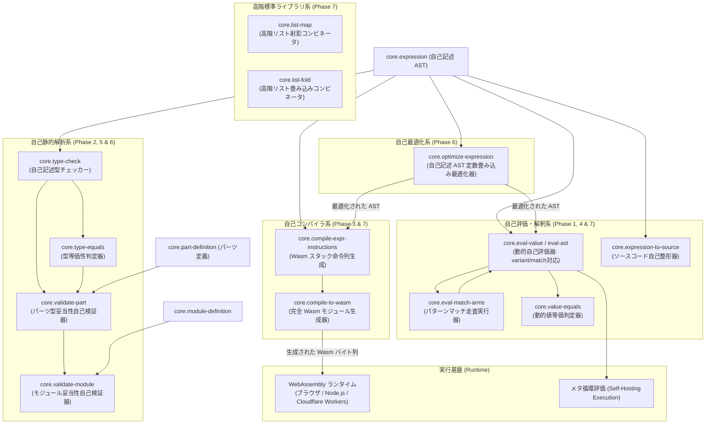

# definy のセルフホスト構想 (Self-Hosting)

definy を definy
自身の言語仕様・データ構造・評価器を用いて表現し、自己記述・自己検証可能にするための設計と実装仕様。

> [!NOTE]
> 実行と検証は TypeScript 側の `wasm/stage1.wasm` の実行パイプライン (`src/stage1_compiler.ts`) と
> Vitest (`src/stage1_conformance.test.ts`, `src/stage1_fixed_point.test.ts` など) で行う。
> シードバンドルの再生成は `npm run build:seeds` (`scripts/generate_seed_bundle.ts`)、`stage1.wasm` の再生成と不動点検証は
> `npm run build:stage1` / `npm run check:stage1` (`scripts/regenerate_stage1.ts`)。
> 2026-10-18 (#699) までは Rust 製のサーバー・コンパイラ (stage0) があり, 古い節の数値やテスト名はその時点のもの。

## 概要

definy
は、構文木（AST）、型システム、パーツやモジュールのメタデータ、そしてそれらの評価器・型チェッカー・コンパイラを
definy
の純粋なデータ構造および式（`Expression`）として自己記述できるセルフホスト環境を実現しています。

これにより、以下の利点が得られます：

1. **コンパイラ・評価器の完全自己完結**:
   外部言語の変更なしに、definy 言語自体の新機能や最適化を definy
   内で記述・検証可能。
2. **決定論的かつコンテンツ指向の言語定義**: 式や型、モジュール構造自体が
   SHA-256 / Ed25519
   によるコンテンツ指向ハッシュで管理され、バージョンロックと不変性が保証される。
3. **安全なマクロ・メタプログラミング**:
   式をデータとして受け取り、式を返す関数を通常パーツとして安全に定義可能。
4. **自己ホスト WebAssembly 生成とエッジ配備**: definy 式から WebAssembly
   バイナリを直接生成でき、外部コンパイラなしでネイティブ/ブラウザおよび
   Cloudflare Workers エッジ上で即時実行可能（詳細は
   [cloudflare-workers.md](cloudflare-workers.md)
   を参照）。

### 実サービスとの接続状況

セルフホスト部品の実行テストは、definy で記述した関数を stage1 でコンパイルして WebAssembly として動かす検証です。
definy サービス全体のブートストラップが完了したことを意味しません。

- `core.type-check`
  は、数値・文字列・真偽値、基本演算、変数、条件分岐、`let`、レコード構築（`record`）、フィールドアクセス（`record_get`）、直和型構築（`variant`）、パターンマッチ（`match`）、リスト式（`list`）、パーツ参照（`part_reference`）、型環境上の関数適用を扱います。
  宣言型を与える `core.type-check-against`
  は関数引数を型環境へ束縛して関数本体を検査します。 lambda
  はパーツ宣言型が要求する関数形に沿う位置か、関数型 parameter への Call
  引数でのみ受け入れます。 lambda を callee
  とする即時適用や、期待関数型のない位置の lambda は拒否します。
  `ModulePartEntry.part_type` はパーツ直下の宣言 metadata であり、式の中に置く型
  marker ではありません。 モジュール内の他パーツ参照（`part_reference`）は
  `type-env` 内の `parts`
  リスト（`core.part-type-env`）を参照して自己解決します。 `core.type-equals`
  は基本型・リスト型・関数型・record 型を再帰比較します。 union 型も variant
  の順序と optional payload 型を含めて比較し、reference 型は part hash
  で比較します。 record/union は定義順を含めて比較します。
- `PartType::Type` は自己ホスト `type-ast` の kind `type` として扱います。
  型定義パーツ内の型構築子（`type_list`, `type_function`, `type_record`,
  `type_union`）は、 `core.type-check-against` により再帰的に型検証されます。
  - **意味検査のセルフホスト化**: `core.list-contains-string`
    を用い、レコード型宣言内の重複フィールドキー（`core.type-check-type-record-fields`）
    およびユニオン型宣言内の重複バリアントタグ（`core.type-check-type-union-variants`）を検出して
    `invalid_type_declaration` エラーとして拒否します。
    また、ユニオン型の空バリアント集合も `invalid_type_declaration`
    として拒否し、 型引数に値式が混入した場合は `type_mismatch` で拒否します。
  - **型定義パーツ自体の相互参照**: 型宣言内の別パーツ参照（`PartReference`）は
    self-hosted AST の `part_reference` 式として変換され、
    モジュール型環境（`part-type-env`）を通じて参照先パーツが `type`
    であるかを解決・検証します。 これにより、`core.validate-module`
    において型パーツ同士の相互参照（レコード型やユニオン型による他型パーツの参照）
    を含むモジュール全体が一括して自己検証されます。 存在しないパーツ参照は
    `part_not_found`、通常の値パーツの型参照は `type_mismatch` で拒否されます。
- イベントの中身の形は core の型パーツ `core.event-content` (`core.module-commit` など) が決め, 署名の検証のときに
  その宣言で形を確かめます ([event.md](event.md))。
- Connect-RPC の `SubmitEvent` は、`checkSubmittedModuleCommit` (`worker/type_check.ts`)
  でコミットのパーツを `core.type-check-against` で検査してから保存します (下の「definy 製型チェッカーの実行」) (UI の型エラー表示・
  seed の検証と同じ入口。下の「seed・UI のパーツ検査」を参照)。型環境は全モジュールの最新のパーツに
  コミットのパーツを重ねたものなので, 他のモジュールのパーツ参照も解決できます。
  パーツの型が変わらなければ式の変わったパーツだけを検査し (core の 1 パーツの編集なら 1 回の評価),
  型が変わればモジュールの全パーツを検査します。式の無いパーツ・`core.expression` で表せないパーツ
  (コンパイラ組み込み) はシステムアカウントのコミットでだけ受け入れます。
  型チェッカーが拒否した場合は `400` を返し, メッセージにパーツ名と型エラーを入れます。
  (以前は `core.validate-module` で全パーツを一括検証していましたが, 型パーツの展開ができず
  core のように大きなモジュールでは重すぎたため置き換えました)
- `core.validate-module(mod_def, external)` は、モジュール内のパーツリスト（`parts`）と外部のパーツ
  (`external`, 他のモジュールのパーツ) から `core.build-type-env` で型環境を作り、
  `core.validate-parts-in-env`
  を呼び出して全パーツを共通の型環境のもとで検査します。
  モジュール内外の他パーツ参照（`part_reference`）と型パーツの展開を含めて検証します (`src/validate_module.test.ts`)。

モジュール内パーツ参照の解決と、リスト・直和型構築・レコード・パターンマッチを含む式検査は
自己記述型チェッカー（`core.type-check` /
`core.type-check-against`）において検証・実証されています。
外部モジュールへのパーツ参照は, definy 製の `core.build-type-env` が全モジュールの最新のパーツから作る型環境を通じて解決しています
(下の「型環境を definy で作る」)。
型定義パーツ自体の自己ホスト循環参照解決などが今後の拡張対象です。

Content-addressed storage は同一 hash・同一 bytes の再保存を成功扱いし、hash
衝突や既存 bytes と異なる内容は拒否します。ModuleCommit
に同じ式が複数回現れても、投稿再試行が CAS 重複で失敗しません。

#### Lambda の配置規則

関数値を作る `function` 式は、期待する `PartType::Function`
に対応する場所だけで有効です。 これはパーツ定義直下の関数本体（curried function
は宣言された関数戻り値型に沿って束ねる）と、 関数型 parameter を受け取る Call
引数です。`((x) => ...)(arg)` のように lambda 自体を callee
にする即時適用は許可しません。関数の呼び出し先はパーツ参照・関数型の引数 (変数)・レコードの関数のフィールドに限り
(`core.callee`), 関数を値として書くこと (関数型の引数をそのまま別の関数に渡すなど) は型エラーにします
([call-syntax.md](call-syntax.md))。

`number` などのパーツ形状も式 node ではなく、パーツ定義の `part_type` metadata
に宣言します。 その宣言型が式 root の期待型になり、`core.validate-part`
が式全体を検査します。

### 今後の実装方針

以下の順で、通常の module 投稿を自己ホスト検証の対象へ広げます。各項目の先頭に到達状況を記します。

1. **[済] 型宣言の意味検査**: record field 名と union tag の重複、空 variant
   集合を `invalid_type_declaration` として拒否し、型パーツ同士の相互参照も解決します（Phase 9〜10）。
   型定義パーツ自体の再帰参照（循環）の規則は未決定です。
2. **[済] module type environment**: `core.build-type-env` が
   全パーツの hash と宣言型 (型パーツは宣言した型も) から環境を作り、
   `PartReference`・構築子・相互参照を解決します。
   サーバー・UI・seed の検証で使う型環境 (`checkModuleCommitParts`, `src/self_hosted_type_check.ts`)
   は全モジュールの最新のパーツから definy 製の `core.build-type-env` で作るので, 他のモジュールのパーツ参照
   (ユーザーのモジュールから `core.list-contains-string` を呼ぶなど) も引数の型まで検査します (`worker/type_check.test.ts` で確認)。
   最新のパーツにコミットするパーツを重ねること, 型が変わったかの判定, 検査するパーツの選択も
   definy 製の `core.type-checker` が行います (下の「型環境を definy で作る」)。
   TypeScript 側に残っているのは, イベントから全モジュールの最新のパーツを集めること (署名の検証・CAS の読み込み) と,
   データの形の変換 (`PartType` → `core.type-ast`) だけです。
3. **[済] 式検査の拡張**: list/record の構築と field access、union constructor、match
   の網羅性を `core.type-check` に追加済みです。UI の型エラー表示も自己ホスト型チェッカーを使います
   （[ui.md](ui.md) の「型エラー表示」を参照）。
4. **[済] bootstrap の固定**: core definitions を `seeds/*.json` として固定し、
   seed から作るバンドルの指紋 (`seeds/seed_bundle_fingerprint.json`) をテストで確かめます。
5. **[済] compiler bootstrap**: definy 製コンパイラは評価器の適合テストを全て通り, 自分自身をコンパイルした結果が
   不動点に達しています (`wasm/stage1.wasm`)。下の「definy 製コンパイラのブートストラップ」を参照。
6. **service host 境界**: 最後に HTTP、database、署名、永続 event log を
   capability-limited host API として公開し、 サーバーの純粋な業務ロジックから
   Definy へ移します（WASI 0.3 スタイルの能力注入設計仕様は
   [wasi-capability-io.md](wasi-capability-io.md)
   を参照）。イベントを受け付ける規則は definy 製の `core.check-event` にした ([event.md](event.md) の「受け付ける規則」)。
   サービス自身のデプロイ・運用ブートストラップ構想（現在は Cloudflare Workers が対象）は
   [deployment-bootstrapping.md](deployment-bootstrapping.md)
   を参照。IO を持つサービス全体の移行は言語 runtime の拡張後です。

### セルフホスティング全体アーキテクチャ



---

## seed JSON が正本

ビルトインモジュール（`definy`, `core`, `std`, `wasi`, `sample`）のパーツ定義の正本は
`seeds/*.json` です (以前は Rust のコードで AST を手組みして JSON を生成していた)。

- パーツ間の参照は `{"$part": "core.expression"}` のように名前で書き, 読み込むときにシステムアカウントの
  モジュール ID からパーツ ID に置き換えます (`src/seed_parts.ts` の `resolvePartPlaceholders`)
- `npm run build:seeds` が `public/__definy_seed_bundle.json` と指紋を作ります ([build-artifacts.md](build-artifacts.md))。
  本番の内容を seed に書き戻すのは `npm run export:seeds` ([seed-export.md](seed-export.md))

## definy 製コンパイラのブートストラップ

definy 製の Wasm コンパイラ (`core.compile-to-wasm` / `core.compile-expr-instructions`) は, 2026-10-17〜18 に
Rust 製コンパイラ (stage0) の上で育て, 評価器の適合テスト (`conformance/eval_cases.json`) の全 65 ケースを通るようにしてから,
stage0 で definy 製コンパイラ自身をコンパイルして stage1 (68,452 バイト) を作った。stage1 で自分自身をコンパイルした
stage2 は stage1 と 1 バイトも違わない (不動点)。その後 Rust 製の stage0 は削除したので, stage1 は今の stage1 でしか
作れない (ブートストラップの種として `wasm/stage1.wasm` をコミットしている)。

### stage1.wasm の再生成

`scripts/regenerate_stage1.ts` を用いて `wasm/stage1.wasm` の再生成と不動点（fixed point）の自動検証を行えます。

```bash
# 再生成と既存バイナリとの一致検証 (CI / テスト向け)
npm run check:stage1

# 再生成して wasm/stage1.wasm に書き出し
npm run build:stage1
```

#### 再生成の手順と検証フロー

1. `seeds/*.json` のパーツ定義を読み込み、開発用システムアカウント鍵から導出した公開鍵を用いてパーツ ID のプレースホルダ (`{"$part": "core.compile-to-wasm"}`) を解決する。
2. `core.compile-to-wasm` への `PartReference` 式から、`collectReferencedParts` により参照される全パーツ (2026-10-21 時点で 63 個) を収集する。
3. 現在の `wasm/stage1.wasm` でコンパイルして `stage2` を生成する (2026-10-21 時点で 85,610 バイト)。
4. 得られた `stage2` のバイナリを使って同じ式を再コンパイルし、`stage3` を生成する。
5. `stage2` と `stage3` が完全一致することを確認する（不動点検証）。`--check` 指定時は既存の `wasm/stage1.wasm` とも比較し、引数なし時は `wasm/stage1.wasm` に書き出す。stage1 を変えたら `npm run build:seeds` で seed バンドルの指紋 (事前コンパイルの結果を含む) も更新する。
6. `src/stage1_fixed_point.test.ts` において、Vitest 経由でも不動点検証が自動テストされる。

#### 参照パーツの順序 (LIFO) とバイト一致

`src/stage1_compiler.ts` の `collectReferencedParts` では、参照パーツの探索キューから**末尾の要素を取り出す LIFO (後入れ先出し)** を採用しています。
stage1 を作った Rust 版と同じ順序で, これを変えると関数表 (Wasm の table) のインデックスがずれて, サイズは同じでも stage1 とバイト一致しなくなります。

#### コンパイラの出力を変えたとき (`--bootstrap`)

stage2 は今の stage1 (古いコンパイラ) でコンパイルしたものなので, コンパイラが出力するコードを変えると stage2 は古い出力をし,
stage3 と一致しない。`npm run build:stage1 -- --bootstrap` は不動点に達するまで (最大 5 回) できたコンパイラで
自分自身をコンパイルし直す。出力を変えない書き換え (リファクタリング) なら `--bootstrap` なしで 1 回で不動点になる。

#### stage1 の再帰の深さとフレームの大きさ (2026-10-21)

以前の stage1 は, `sample.self-hosted-definy-server` の handler のコンパイルに Node.js で 16MB 以上のスタックと約 10 秒,
コンパイラ自身のコンパイルに 4MB のスタックを要し, Cloudflare Workers ではどちらもスタックオーバーフローした。原因は 3 つ:

1. **リストの長さだけ深くなる再帰**: `collect-functions-in-list` などの補助関数が `f(items[i]) +++ 自分(i + 1)` の形で,
   子の多い式 (`core.wasm-runtime-functions` の数千要素のリストなど) で数千段再帰していた。
   当時の生成コードは末尾呼び出しを最適化しなかった (`return_call` を出さなかった) ので, 末尾再帰でも深さは減らなかった
2. **二乗のリストの連結**: 右に入れ子になった `a +++ (b +++ (c +++ ...))` は外側の連結のたびに内側を丸ごとコピーする
   (`list_concat` は新しいリストにコピーする)。時間の 82% がランタイム関数 `list_concat` だった
3. **大きなフレーム**: 生成する関数がすべて i32 のローカル変数を 512 個固定で宣言していた (1 フレーム 2KB 以上)

対策 (seeds/core.json):

1. 2 の対策も兼ねて, 補助関数 `H(items, index, ...)` を, 範囲 `[lo, hi)` を半分に割って `H-range(lo, mid) +++ H-range(mid, hi)`
   とする `H-range` に任せる (分割統治)。深さは O(log n), 連結のコピー量は O(n log n) になる。右半分に渡す `fn_base`
   (それまでの関数の数) は `count-functions-in-range` などで左半分の分を数えて進める。出力は変わらない。
   `repeat-number` / `uleb-range` も count を半分に割る
2. `core.max-local(expr, depth, ctx)` で, 式が使うローカル変数の番号の上限を求めて宣言する
   (式が 1 段深くなるごとに使うローカル変数は高々 2 つ増え, 関数の本体は別の関数になり,
   関数でないパーツへの参照は同じ depth で展開される)。多めに見積もる分には安全で,
   少なすぎれば Wasm の検証エラーになる (気づかずに壊れることはない)

結果: handler は既定のスタックで 0.7 秒 (100KB のスタックでも足りる), コンパイラ自身も 100KB で足りる。
`npm run build:stage1` / `check:stage1` に `--stack-size` は要らなくなった。
残る深さは式の入れ子の深さ (末尾位置でない, 正当な再帰)。

#### 末尾呼び出し (`return_call_indirect`, 2026-10-21)

関数の本体の末尾位置の呼び出しは `return_call_indirect` (Wasm の tail call 拡張, opcode 0x13) にする。
definy には例外による大域脱出がなく, スタックトレースも要らないので, 末尾位置の呼び出しはすべてフレームを使い回してよい。

- `core.compile-call(e, env, depth, fn_base, ctx, opcode)`: 呼び出し式の命令列。最後にクロージャを `opcode` の命令で呼ぶ
  (通常は `call_indirect` = 17, 末尾位置では `return_call_indirect` = 19)
- `core.compile-tail-instructions`: 末尾位置の式。呼び出しは `return_call_indirect` にし, `let` の本体と `match` のアームの本体
  (`core.compile-match-arms-tail`) は末尾位置のまま再帰する。それ以外は `core.compile-expr-instructions`
- `core.compile-function-body` は関数の本体を `compile-tail-instructions` でコンパイルする (`evaluate` は対象外)

`return_call_indirect` は呼び出し先と呼び出し元の結果の型が同じなら使える。クロージャも関数本体も型 3 (`(i32, i32) -> i32`) なので満たす。
これで `loop(n, acc) = n <= 0 ? acc : loop(n - 1, acc + 2)` のような末尾再帰は 100 万回でもスタックを消費しない
(以前は 10 万回で溢れた。`src/stage1_compiler.test.ts` で確かめる)。stage1 自身もこの出力なので, `compile-env-lookup` や
`compile-find-part` などの線形の探索もスタックを使わない。V8 (Node.js 20 以降, Chrome 112 以降, Cloudflare Workers),
Firefox 121 以降, Safari 18.2 以降が対応している。

### 本番での stage1 の使い方

- stage1 は外部 import の無い静的な Wasm なので, ブラウザ・Node.js・Cloudflare Workers のどれでもそのまま動く
- Cloudflare Workers は実行時に作った Wasm をコンパイルできないので, stage1 の **出力** を Worker の中では動かせない。
  型チェッカーはビルド時にコンパイルして Worker にバンドルし (下の「definy 製型チェッカーの実行」),
  デプロイする Wasm は Cloudflare の API にアップロードして向こうでコンパイルさせる ([cloudflare-workers.md](cloudflare-workers.md),
  [worker-runtime.md](worker-runtime.md))
- 未着手: 文字列リテラルを 1 バイトずつ書く命令にしている。データセグメントにまとめたい

### 値の表現 (線形メモリの形)

すべての値を「線形メモリ上のタグ付きの箱」へのポインタ (i32) で表します。実行結果の読み取りは `src/stage1_compiler.ts` が行います。

| タグ | 値                | 形                                                                   |
| ---- | ----------------- | -------------------------------------------------------------------- |
| 0    | 数値              | +8 に i64                                                            |
| 1    | 真偽値            | +8 に 1 バイト                                                       |
| 2    | 文字列            | +4 に長さ (バイト数), +8 から UTF-8 のバイト列                       |
| 3    | リスト            | +4 に要素数, +8 から要素の箱へのポインタ                             |
| 4    | レコード          | +4 にフィールド数, +8 から (キーの文字列の箱, 値の箱) のポインタの組 |
| 5    | 関数 (クロージャ) | +4 に関数表の番号, +8 に捕捉した変数の配列 (無ければ 0)              |
| 6    | バリアント        | +4 にタグの文字列の箱, +8 にペイロードの箱 (無ければ 0)              |

- メモリは確保するだけで解放しません (1 回の評価は短いので)。ヒープの先頭はグローバル変数 0 で, 確保は 8 バイト境界に揃え,
  足りなければ `memory.grow` します。確保したばかりのメモリは 0 なので, 数値の箱はタグを書かずに済みます
- 出力するモジュールは `evaluate` 関数 (結果の箱のポインタを返す), `memory`, 関数表 `table`, メモリを確保する `alloc` をエクスポートします (デプロイ先の `worker.js` のために, `evaluate` を `main` としてもエクスポート)。`table` と `alloc` は, 外から値を書いて関数を呼ぶため (`instantiateCompiledFunction`)。
  `match` で真偽値のタグとして使う文字列 `"true"` `"false"` だけはデータセグメント (1024 番地) に置きます
- ランタイム関数 (メモリの確保, 数値・真偽値の箱詰め, 文字列の比較, 値の比較, `record_get`, リストと文字列の操作,
  `match` のタグとペイロードの取り出し) は Wasm の関数 1〜14 として毎回モジュールに含めます。本体は `core.wasm-runtime-functions`
  に固定のバイト列として入っています。組み立てるスクリプトは `scripts/wasm_runtime_functions.py`
  (`python3 scripts/wasm_runtime_functions.py seeds/core.json` で seed のこのパーツだけを書き換える)
- 文字列のリテラル・レコードのキー・バリアントのタグは, 実行時に箱を確保して 1 バイトずつ書きます。
  データセグメントにまとめれば命令列を小さくできますが, コンパイラ全体に「どこに何を置いたか」の状態を引き回す必要があるので後回し
- ローカル変数は i32 を 512 個宣言し, 式の深さ (`depth`) ごとに 1 つずつ一時領域として使います。`let` と `match` のアームで
  束縛した変数もその深さのローカル変数に置き, 変数 ID からローカル変数への対応 (`env`) を `core.compile-expr-instructions` に渡します。
  兄弟の式は同じ深さを使い回せます (先に評価した値はスタックに積まれていて, ローカル変数には残っていないため)
- 値がすべて箱に入っていて実行時にタグで種類が分かるので, 式全体の型をコンパイル時に求める必要はありません
- 未対応の式と, どのアームにも一致しない `match` は `unreachable` にします

### 関数・呼び出し・パーツ参照

- 関数は Wasm の関数 (型 `(env_ptr, args_ptr) -> i32`) にし, 関数表 (table 0) に並べます。Wasm の関数番号は
  15 (ランタイム関数の後ろ) から, 関数表の番号は 0 から
- 関数の値はクロージャの箱 (タグ 5)。関数の式を評価すると, 本体の自由変数 (`core.free-variables`) を環境の配列に詰めて箱を作る。
  関数の本体は, 引数の配列 (第 2 引数) からパラメーターを, 環境の配列 (第 1 引数) から捕捉した変数をローカル変数に読み込んでから始まる
- 呼び出しは, 関数の値と引数の配列 (引数は書いた順) を作って `call_indirect`
- **関数の番号の付け方**: definy には状態が無いので, コンパイルしながら関数を集めて番号を振ることができない。そこで
  - `core.collect-functions` で式の中の関数の式を前順 (自身が先, 次に子を `core.expression-children` の順) に並べ, その位置を番号にする
  - `core.compile-expr-instructions` は引数 `fn_base` (その式の中で最初の関数の番号) を受け取り, 子をコンパイルするときは
    前の兄弟に含まれる関数の数 (`core.count-functions`) を足して渡す。こうすると集めたときと同じ番号になる
- **パーツ参照**: 呼び出し側 (`src/stage1_compiler.ts` の `collectReferencedParts`) が, 式から参照をたどって集めたパーツを
  `parts: list<{ id, expression }>` として `core.compile-to-wasm` に渡す。関数表には, 式の中の関数の後ろに各パーツの式の中の関数を続ける
  (`core.compile-assign-part-bases` で各パーツの最初の番号を求める)。
  関数のパーツへの参照は, その番号のクロージャ (環境なし) になる。関数でないパーツへの参照は, 参照した場所でパーツの式をコンパイルする
  (パーツの中の関数の番号はパーツの最初の番号から数えるので, どこでコンパイルしても同じ)。インライン化中のパーツを再び参照したら `unreachable`
- 式を持たないパーツや `core.expression` で表せないパーツは渡さないので, 参照すると `unreachable`.
  コンパイラ組み込みのパーツは式 `builtin(name)` のまま渡し, その呼び出しは `core.compile-builtin-call` が名前で命令列にする ([builtin-parts.md](builtin-parts.md))
- 引数は名前ではなく書いた順に渡す

### definy 製型チェッカーの実行 (2026-10-21)

definy 製型チェッカーは stage1 でコンパイルして動かす (`src/self_hosted_type_check.ts`)。

- **1 度だけコンパイルして何度も呼ぶ**: `compileTypeChecker` が `core.type-checker` への
  `PartReference` を stage1 でコンパイルする (関数を返す式の Wasm になる)。`checkParts` は
  `instantiateCompiledFunction` (`src/stage1_compiler.ts`) でインスタンスを作り, 型環境に入れるパーツを 1 度だけ線形メモリに
  書き込んで呼ぶ。返った「その型環境で検査する関数」を `callClosure` で, パーツごとに `expr`・`expected_type` を書き込んで呼ぶ。seed の 169 パーツで, コンパイル 335ms・検査 600ms ほど
  (パーツごとに `let env = ... in [check(a), ...]` の式をコンパイルし直していたときは 73 秒かかった)。
  線形メモリは解放しないので 32 パーツごとにインスタンスを作り直し, trap したときも作り直す
- **値の書き込み** (`writeLiteral`): 型環境のような大きな値を線形メモリに書くので, 1 度だけ走査して JavaScript 側の
  `Uint8Array` に相対アドレスで書き, `alloc` した位置に合わせてポインタを直してから写す。以前の (2 回走査して小さな配列を
  `push(...bytes)` でつなぐ) 実装は workerd で型環境 1 つに 600ms かかっていた
- **サーバーの型環境の読み込み**: モジュールコミットはイベントハッシュごとに, 署名の検証・デコード・式のハッシュ
  (ネイティブの SHA-256) をした結果を isolate の中で使い回す (`commitCache`, 型パーツ以外の式は捨ててメモリを節約する)。
  ローカルの 33 コミット (9.4MB) で, isolate の最初の `SubmitEvent` は 2.4 秒, 2 回目からは 200ms ほど (型検査なしで 80ms)
- **型チェッカーはビルド時に作る**: Cloudflare Workers は実行時に Wasm をコンパイルできないので,
  `npm run build:seeds` が seed の型チェッカーを `wasm/type_checker.wasm` (コミットしない) に書き出し,
  Worker は `?module` で取り込む ([build-artifacts.md](build-artifacts.md))。本番で `core` の型チェッカーを編集しても,
  seed に書き戻してデプロイするまでサーバーの検査には反映されない
- **`SubmitEvent` の検査** (`worker/type_check.ts`): 署名の正しいモジュールコミットから, モジュールごとに最新のコミットの
  パーツを集めて型環境にし, 投稿されたコミットのパーツを重ねて `checkModuleCommitParts` で検査する。
  型が 1 つも変わらなければ式が変わったパーツだけ, 変われば全パーツを検査する。式を CAS に預けたパーツは読んでから検査し,
  CAS に足りない内容があるときは検査せず `missing_content` を返す。型エラーは `400` (`invalid_argument`) で,
  メッセージは `part 'name': type error: type_mismatch {...}` の行。システムアカウントは式の無いパーツや
  コンパイラ組み込みを検査せずに受け入れる。`worker/type_check.test.ts` で確かめる
- **seed の検査**: `src/self_hosted_type_check.test.ts` が seed の全パーツ (コンパイラ組み込みの `core.number-literal` を除く)
  が型エラーなしで通ることを確かめる。作り直したときに `core.compile-call-arguments-range` が
  `core.count-functions-in-values-range` (`{key, value}` のリストを取る) に呼び出しの引数 (`{name, value}` のリスト) を
  渡している型エラーが見つかり, `core.count-functions-in-arguments-range` を分けて直した

### 型環境を definy で作る (2026-10-23)

以前は TypeScript (`typeEnvExpression`) が `core.type-env` の値を組み立てていた (型パーツの宣言式を
`expressionToPartType` で型にして `{hash}#definition` のキーで入れるところまで)。いまは次の core のパーツが行う。

- `core.type-checker(latest, committed, module_id) -> { to_check, without_expression, check }`: サーバー・UI・seed の検査は
  これをコンパイルして使う (`createModuleCommitSession`)。`latest` は全モジュールの最新のパーツ, `committed` はモジュール
  `module_id` にコミットするパーツで, どちらも
  `list<{ part_id, module_id, part_type: option<type-ast>, type_declaration: option<expression>, expression_key: option<string>, has_expression }>`。
  - 型環境: `latest` から `module_id` のパーツを除き (`core.module-entries-in-module`), `committed` を足して
    `core.build-type-env` で作る。型の無いパーツは入れない (`core.module-entries-to-type-env-entries`)
  - 型が変わったか (`core.module-entries-types-changed`): パーツの数が変わったか, 新しいパーツか宣言型の違うパーツ
    (`core.option-type-equals`) があれば変わった
  - 検査するパーツ (`core.module-commit-classify`): 型が変わっていなければ, `expression_key` が前のコミットと同じパーツを
    飛ばす (`none` は比べられないので飛ばさない)。式か型の無いパーツは `without_expression` に入れる
    (TypeScript 側がシステムアカウント以外なら拒否する)
  - `check`: その型環境で `core.type-check-against` を呼ぶ関数 (`core.type-checker-in-env`)。TypeScript からは
    `recordField` でレコードのフィールドのポインタを取り, `callClosure` で呼ぶ
  - コミットせずに型環境だけ欲しいとき (UI の裏の検査, パーツ詳細) は `committed` を空にし, `module_id` に
    どのモジュール ID とも一致しない `#` を渡す (`createTypeCheckSession`)
- `core.build-type-env(entries) -> type-env`: `entries` は `list<{ part_definition_event_hash, part_type: type-ast, type_declaration: option<expression> }>`。
  各パーツの宣言型を入れ, `type_declaration` が `some` (型パーツ) なら宣言している型も `{hash}#definition` で入れる
  (`core.build-type-env-parts`)
- `core.type-declaration-to-type-ast(expr) -> option<type-ast>`: 型パーツの宣言式 (`type_number`・`type_list`・`type_function`・
  `type_record`・`type_union`・`part_reference`) を宣言している型にする。型の式でないか, 中に変換できないものがあれば `none`
  (`core.type-declaration-parameters-to-type-ast` などがリストの要素を変換する)

TypeScript 側 (`moduleEntriesExpression`) は, パーツの宣言型 (`core.type-ast` の値) と型パーツの宣言式
(`core.expression` の値) を保存した形のまま渡すだけになった ([value-encoding.md](value-encoding.md))。

書き方の注意: `option` を返す補助パーツで, 変換した要素を `let` などで受けてから `some` で包むと, `match` のアームの型
(`union[none]` と `union[some(...)]`) が推論で揃わず型エラーになる。要素を変換したらそのまま再帰呼び出しに渡し,
戻り値の位置 (期待型のある位置) でだけ `some` / `none` を返すようにした。

### 未入力 (`hole`) と期待する型 (2026-10-23)

`core.expression` に `hole({ probe: boolean })` を足した。UI の式エディタが選んだ位置の期待する型を
型チェッカーに聞くためのもので ([dynamic-layout.md](dynamic-layout.md)), サーバーや評価には渡さない。

- `core.type-check-against-unlocated`: `probe` なら `error(hole_expected_type { expected: some(期待する型) })`,
  そうでなければ `ok(期待する型)` (未入力はどの型にもなれる)
- `core.type-check-unlocated` (推論): `probe` なら `error(hole_expected_type { expected: none })`,
  そうでなければ `error(unfilled_hole)`
- 型チェッカーは最初に見つけたエラーを返すので, probe より先に別の型エラーや推論する位置の未入力があると期待する型は分からない
- 推論する位置の式 `t` の型を聞きたいときは `[t, probe]` のリストにする. リストは最初の要素の型を推論し,
  残りの要素ではその型を期待するので, probe の期待する型が `t` の型になる (match の対象の型, `probeMatchTargetType`).
  ただし期待型のある位置 (関数の本体・型の決まった引数など) にリストを置くと, リストが期待型と合わずに probe より先に型エラーになる.
  どの位置でも聞けるようにするには `let _ = [t, probe] in t` にする (let は束縛の値を推論する. `probeInferredTypeAt`,
  式のホバー表示で使う). 束縛の変数 ID は式全体で使われていないもの (`nextVariableId`) にする
  `==` の右辺は左辺の型を期待せず推論するので使えない

### 型パーツを指定した Variant の型 (2026-10-23)

`core.expression` の `variant` に `type_part: option<string>` (型パーツの ID) を足した.

- `core.type-check-unlocated` (推論): `type_part` が `some(id)` で, `core.type-resolve` した型パーツが直和型なら,
  `core.type-check-against` でタグと値を検査して `reference(id)` と推論する. それ以外は今までどおり,
  そのタグだけの直和型 (`union [{ tag, payload_type }]`) と推論する
- 検査する位置 (`core.type-check-against-unlocated`) は今までどおり期待する型でタグと値を検査する
- `type_part` は型検査だけが使い, コンパイル (`core.compile-expr-instructions`) と評価 (`core.eval-value`) は見ないので,
  足しても `wasm/stage1.wasm` は変わらない (`npm run check:stage1` が通る)
- `core.expression` のレコードにフィールドを足すと, そのレコードを組み立てる definy のコードは全てのフィールドを書く必要がある
  (型チェッカーが必須フィールドを検査する). 今は `variant` の式を組み立てるのは TypeScript の変換だけ

### 次に進める順番の案

1. 文字列リテラルなどをデータセグメントにまとめて, 出力を小さくする
2. サーバーの業務ロジック (イベントの検証・保存など) を definy のパーツに移す

## セルフホストのロードマップと到達状況

- [x] **Phase 1: 完全動的値評価器 (Self-Evaluating Interpreter)**
  - 動的値型 `core.value`、変数環境型 `core.env`、環境探索
    `core.env-lookup`、環境拡張 `core.env-extend`
  - 完全動的値自己評価器 `core.eval-value`: `expression -> env -> value`
- [x] **Phase 2: 自己記述型チェッカー (Self-Hosted Type Checker)**
  - 型エラー型 `core.type-error`、型検査結果型 `core.type-result`、型環境
    `core.type-env`
  - 型等価性判定 `core.type-equals`
  - 静的型検査器 `core.type-check`: `expression -> type-env -> type-result`
  - `core.type-check-against` による宣言型ベースの lambda 検査と inline type
    declaration の kind 検証
- [x] **Phase 3: 自己ホスト WebAssembly コンパイラ (Self-Hosted Wasm Compiler)**
  - 式スタック命令列コンパイラ `core.compile-expr-instructions`:
    `expression -> list<number>`
  - 完全 WebAssembly バイナリ生成器 `core.compile-to-wasm`:
    `expression -> list<number>`
  - 生成した Wasm の即時実行・検証を実証完了
- [x] **Phase 4: 自己記述フォーマッター・メタ循環評価 (Self-Hosted Formatter &
      Meta-Circular Execution)**
  - 自己記述コード整形器 `core.expression-to-source`: `expression -> string`
  - 構文拡張: `let`, `not`, `and`, `or` の完全自己評価 (`core.eval-value`) &
    型検査 (`core.type-check`)
- [x] **Phase 5: パーツ自己検証器 & 完全自己ホストコンパイル実証
      (Self-Validation & End-to-End Compiler Execution)**
  - パーツ妥当性自己検証器 `core.validate-part`: `part-definition -> boolean`
  - Wasm 命令列コンパイラ `core.compile-expr-instructions` の論理演算（`not`,
    `and`, `or`）対応
  - 自己記述コンパイラ `core.compile-to-wasm` による Wasm
    生成・即時実行の実証完了
  - 汎用自己評価器 `core.eval-value`、自己型チェッカー
    `core.type-check`、自己バリデータ `core.validate-part` のメタ循環実証完了
- [x] **Phase 6: 自己記述 AST 最適化器 & モジュール全体自己検証 (Self-Hosted
      Optimizer & Module Validation)**
  - 自己記述 AST 最適化器 `core.optimize-expression`: `expression -> expression`
    - 定数畳み込み（Constant Folding: 算術演算、論理否定、条件分岐の枝刈り）
    - 最適化された AST からの Wasm 生成 & 即時実行実証完了
  - モジュール妥当性自己検証器 `core.validate-module`:
    `module-definition -> boolean`
    - モジュール名検証（非空文字チェック）および全パーツの型妥当性の網羅検証実証完了
- [x] **Phase 7: 直和型・パターンマッチ自己評価 & 動的等価判定 &
      高階コレクションコンビネータ (Self-Hosted ADT Pattern Matching &
      Collections)**
  - Wasm コンパイラでの文字列の等価比較（Tag 2: String のバイト列比較）
  - 動的値等価性自己判定器 `core.value-equals`: `value -> value -> boolean`
  - 直和型構築 `variant` 式の自己解釈実行（`core.eval-value`）
  - パターンマッチ `match` 式の完全自己解釈実行（`core.eval-match-arms`,
    `core.eval-match-arms-inner`
    による先頭からの線形マッチと拡張環境上での本体評価）
  - 高階リスト操作コンビネータ `core.list-map`:
    `(a -> b) -> list<a> -> list<b>`、`core.list-fold`:
    `(b -> a -> b) -> b -> list<a> -> b`
  - メタ循環パターンマッチ実行および高階リスト処理の実行実証完了
- [x] **Phase 8: レコード構築・フィールドアクセスの自己ホスト型検査 &
      自己評価拡張 (Self-Hosted Record & Field Access)**
  - 型エラー型 `core.type-error` に `not_a_record`, `field_not_found` を追加
  - レコードフィールド型探索 `core.record-field-type-lookup`
    およびレコード型検査器 `core.type-check-record-fields` を新設
  - 静的型検査器 `core.type-check` に `record`（レコードリテラル）および
    `record_get`（フィールドアクセス）の型検査アームを追加
  - 動的値型 `core.value` に
    `record(value: list<{ key: string, value: value }>)` を追加
  - 動的フィールド値探索 `core.record-field-lookup` およびレコード動的評価器
    `core.eval-record-fields` を新設
  - 完全動的値評価器 `core.eval-value` に `record` リテラルの評価および
    `record_get` によるフィールド値アクセスの評価アームを追加
  - 動的等価判定器 `core.value-equals` に `core.value-equals-record-fields`
    を追加し、動的レコード同士の順序依存・キー/値再帰等価比較に対応
  - Wasm コンパイラの `match` でワイルドカード `_` を無条件に一致させる
  - レコード式の型検査・動的自己評価・動的等価判定およびパーツ妥当性検証（`core.validate-part`）のメタ循環実証完了
- [x] **Phase 9: 直和型（Union）・パターンマッチ（Match）の自己ホスト型検査 &
      網羅性検証 (Self-Hosted Union Variants & Pattern Match Type Checking)**
  - 型エラー型 `core.type-error` に `not_a_union`, `variant_not_found`,
    `non_exhaustive_match` を追加
  - 直和型探索・検証パーツ群（`seeds/core.json`）を新設
    - `core.union-variant-type-lookup`:
      直和型から指定タグのペイロード型を線形探索（引数なし variant は `{}`
      レコード型として統一）
    - `core.find-tag-in-arms`: マッチアーム一覧に対象タグが含まれるかを線形探索
    - `core.check-union-exhaustiveness`:
      直和型の全タグがマッチアームに網羅されているかを検証し、欠落時に
      `non_exhaustive_match` を返却
    - `core.type-assignable-union-variants`:
      直和型の双対的幅サブタイピング（$Actual \subseteq Expected$）を再帰検証
  - パターンマッチ型検査パーツ群（`seeds/core.json`）を新設
    - `core.type-check-match-arms-inner`（現在は `core.type-check-match-arms-infer` /
      `core.type-check-match-arms-skipped` の 2 段階に置き換え。Phase 2 の 6 を参照）:
      各アームの環境拡張、本体型検査、戻り値型一致検証（初出アーム型との
      `type-assignable`）、全走査完了後の網羅性検査の呼び出し
    - `core.type-check-match-arms`: パターンマッチ型検査のエントリーポイント
  - 静的型検査器 `core.type-check` に `variant`（直和型値の生成・型推論）および
    `match`（パターンマッチ式）の型検査アームを追加
  - 型代入適合性検査器 `core.type-assignable`
    に直和型同士の部分型関係（サブタイピング）検証を追加
  - 単体バリアント推論、双対的サブタイピング代入、全アーム型一致、網羅性欠落エラー検出、未知バリアントエラー検出のメタ循環実証完了
- [x] **Phase 10: リスト式（List Literal）の自己ホスト型検査 &
      共変サブタイピング (Self-Hosted List Type Checking & Covariant
      Subtyping)**
  - 型エラー型 `core.type-error` に `cannot_infer_empty_list` を追加
  - リスト型検査パーツ群（`seeds/core.json`）を新設
    - `core.type-check-list-items`:
      リストリテラルの各要素を期待される要素型に対して再帰検査し、全要素適合時に
      `ok(list({ item_type }))` を返却
    - `core.type-check-list`: リストリテラルの要素型を推論（空リスト時は
      `cannot_infer_empty_list`
      を返し、要素がある場合は先頭要素から型を推論して残りを検証）
  - 静的型検査器 `core.type-check` に `list` 式の型検査アームを追加
  - 期待型照合検査器 `core.type-check-against` に `list`
    式アームを追加し、空リスト `[]` に対する期待型適合（双方向型推論）に対応
  - 型代入適合性検査器 `core.type-assignable`
    にリスト型の共変サブタイピング（$ActualItem \le ExpectedItem \implies list<ActualItem> \le list<ExpectedItem>$）を追加
  - 数値・文字列リストの型推論、空リスト推論拒否、期待型付き空リスト検査、異種要素不一致エラー検出、レコードリストの共変代入適合性のメタ循環実証完了
- [x] **Phase 11: Seed データの分離・固定化と JSON Schema によるブートストラップ
      (Self-Hosted Seed Decoupling & Schema Validation)**
  - 手組みの AST をやめ, テキスト形式の静的定義データ (`seeds/*.json`) を正本にした
    （[seed JSON が正本](#seed-json-が正本) を参照）。JSON Schema (`seeds/schemas/`) でエディタの補完・検証が効く

---

## セルフホスト用ビルトインパーツ (`core` モジュール)

### Phase 1: 動的値・環境と完全評価器

#### 1. 動的値型: `core.value`

ランタイム実行時の動的値を表現する直和型（Union Type）。

- `number(value: number)`: 数値
- `string(value: string)`: 文字列
- `boolean(value: boolean)`: 真偽値
- `list(value: list<value>)`: リスト値
- `closure({ parameter_id: number, body: expression, captured_env: env })`:
  レキシカルスコープを保持する関数クロージャ
- `variant({ tag: string, payload: value })`: タグ付き直和型値
- `unit`: 空値

#### 2. 変数環境型 & 補助関数: `core.env`, `core.env-lookup`, `core.env-extend`

- `core.env`: `list<{ variable_id: number, value: value }>`
- `core.env-lookup`:
  `env -> variable_id -> value`（環境の末尾から最新の束縛を線形探索）
- `core.env-extend`:
  `env -> variable_id -> value -> env`（環境の末尾に新しい変数値を追加）

#### 3. 完全動的値評価器: `core.eval-value`

```definy
eval-value: expression -> env -> list<{ id: string, expression: expression }> -> value
```

3 つ目の引数 `parts` は式が参照するパーツで, `core.compile-to-wasm` の `parts` と同じ形です。
評価器の適合テストの全 67 ケースを stage1 と同じ値に評価します ([eval-conformance.md](eval-conformance.md))。

- リテラル（数値・文字列・真偽値）
- レキシカルスコープ環境による変数解決（`variable`）
- 条件分岐（Bool に対する `match`。対象が `boolean` のときタグ `"true"` / `"false"` のアームを選ぶ）
- 関数定義時における環境キャプチャ（クロージャ生成）
- 関数呼び出し（`call`）時におけるキャプチャ環境の復元と引数束縛
- コンパイラ組み込みのパーツ (`core.plus` `core.string-concat` `core.list-get` など) の呼び出し.
  `builtin(name)` は値 `builtin(name)` になり, それを呼ぶと `core.eval-builtin-call` が名前ごとに評価する
- パーツ参照（`part_reference`）。`parts` から探して空の環境で評価する（`core.eval-part-reference`）

---

### Phase 2: 自己記述型チェッカー

#### 1. 型エラー型 & 結果型: `core.type-error`, `core.type-result`

- `core.type-error`:
  - `type_mismatch({ expected: type-ast, actual: type-ast })`: 型の不一致
  - `undefined_variable({ variable_id: number })`: 未定義の変数参照
  - `part_not_found({ part_definition_event_hash: string })`:
    モジュール型環境にパーツ定義が存在しない
  - `cannot_infer_empty_list`: 期待型のない空リストの型推論失敗
  - `unknown_error`: 未知のエラー
  - `located({ expression: core.expression, error: type-error })`: エラーと, それを見つけた一番内側の式の組
- `core.type-result`: `ok(type-ast) | error(type-error)`
- エラーの場所: `core.type-check` / `core.type-check-against` は本体 (`core.type-check-unlocated` /
  `core.type-check-against-unlocated`) を呼んで, `located` でないエラーを今検査している式と組にして返すだけのパーツ.
  本体の中の再帰呼び出しはこの包むほうを呼ぶので, 一番内側でエラーを返した呼び出しの式が付く.
  - 式の型を推論してから `type-equals` で比べると, エラーはその親の式に付いてしまう.
    組み込みのパーツ (`core.plus` など) の呼び出しの引数は `core.type-check-builtin-call` が `type-check-against` で
    期待する型 (`number` など) に照らして検査し, 引数の式にエラーが付くようにしている
  - UI (パーツ詳細) は `located` の `expression` と同じ値になるツリーの式 (`findTypeErrorPath`,
    `src/tree_layout/type_error_location.ts`) の横に警告を出す. 同じ式が何か所にもあれば表示順で最初のもの

#### 2. 型環境型: `core.type-env`, `core.part-type-env`, `core.type-env-lookup`, `core.type-env-extend`, `core.part-type-lookup`, `core.type-env-lookup-part`

- `core.part-type-env`:
  `list<{ part_definition_event_hash: string, part_type: type-ast }>`
  - モジュール内のパーツ定義ハッシュと宣言型の対応関係を保持する環境。
- `core.type-env`:
  `{ variables: list<{ variable_id: number, var_type: type-ast }>, parts: list<{ part_definition_event_hash: string, part_type: type-ast }> }`
  - ローカル変数の静的スコープ束縛とモジュール内パーツ宣言型を統合した二層の型環境。
- `core.type-env-lookup`: `type-env -> number -> type-result`（変数の型を検索）
- `core.type-env-extend`:
  `type-env -> number -> type-ast -> type-env`（変数の型束縛を追加）
- `core.part-type-lookup`:
  `part-type-env -> string -> type-result`（パーツ宣言型を検索）
- `core.type-env-lookup-part`:
  `type-env -> string -> type-result`（統合環境からパーツ宣言型を検索）

#### 3. 型等価性判定: `core.type-equals`

```definy
type-equals: type-ast -> type-ast -> boolean
```

2つの `type-ast` が同一の型であるかを再帰的に判定。

#### 4. 静的型チェッカー: `core.type-check`

```definy
type-check: expression -> type-env -> type-result
```

definy の式 AST
を静的に走査し、型安全性を検証して最終的な型または詳細な型エラーを返却。

#### 5. 期待型に対する検査: `core.type-check-against`

```definy
type-check-against: expression -> type-env -> type-ast -> type-result
```

式・型環境に加えて期待型を受け取る bidirectional checker です。`function`
式では期待型の parameter を環境へ束縛して body を return type
に照らして検査します。`call` 式は環境から 関数型を得て、引数型と parameter
の一致を確認してから return type を返します。 引数型注釈を持たない lambda
の型は、宣言された期待関数型から決めます。

#### 6. seed・UI のパーツ検査 (`src/self_hosted_type_check.ts`)

UI の型エラー表示・サーバーの `SubmitEvent`・seed の検証 (`src/self_hosted_type_check.test.ts`) は
`core.type-checker` をコンパイルして `core.type-check-against` を呼びます (上の「definy 製型チェッカーの実行」)。
パーツの式は `core.expression` の値のまま保存しているので, 変換せずに渡します ([value-encoding.md](value-encoding.md))。
seed のパーツはコンパイラ組み込み (`core.number-literal`) 以外すべて型エラーなしで通ります。

- **型パーツの展開**: 型パーツは `reference({ part_hash })` 型で表します。型環境には型パーツの
  宣言した型を `{hash}#definition` のキーでも入れ, `core.type-resolve` がそれを使って中身の型に展開します。
  `call`・`record_get`・`match` の対象, `type-check-against` の期待型は展開してから見ます。
  `core.type-assignable` 系は `env` 引数を取り, 片方だけが `reference` のときは展開して比べます。
  両方 `reference` ならハッシュが同じときだけ代入できます (名前的型付け)。
- **双方向検査**: `type-check-against` は `variant`・`match`・`let`・`record` と, `core.list-append`・`core.list-concat`・
  `core.list-get` の呼び出し (`core.type-check-against-builtin-call`) も期待型で検査します (`type-check-record-fields-against` など)。
  空リストや `none` を期待型から決められるのはこのためです。
- **match の推論は 2 段階**: `core.type-check-match-arms-infer` が推論できるアームから型を求め
  (アームごとに広い方の型を採る), 推論できなかったアーム (空リストなど) を
  `core.type-check-match-arms-skipped` がその型で検査します。
  `_` アームは何も束縛せず, `find-tag-in-arms` ではすべてのタグに一致します。
  対象の型に無いタグでペイロードを束縛しないアーム (`variable_id` が負) は到達しないアームとして許します
  (`core.match-arm-env`)。
- **組み込みのパーツ**: 型環境では組み込みのパーツの型を `builtin(name)` にし, その呼び出しを `core.type-check-builtin-call` が
  名前ごとに検査します (比較・文字列・リストの操作など. 引数名は `core.builtin-parameters` と順番どおり一致させる)。

---

### Phase 3: 自己ホスト WebAssembly コンパイラ

#### 1. スタックマシン命令列コンパイラ: `core.compile-expr-instructions`

```definy
compile-expr-instructions: expression -> list<number>
```

式 AST を WebAssembly
のバイトコード命令列（`list<number>`）へ再帰的に変換します。

- `number`: `i64.const` (`0x42`) + LEB128 エンコードバイト列
- 組み込みのパーツの呼び出し (`core.compile-builtin-call`):
  - `core.plus`: 左辺命令列 + 右辺命令列 + `i64.add` (`0x7c`)
  - `core.minus`: 左辺命令列 + 右辺命令列 + `i64.sub` (`0x7d`)
  - `core.multiply`: 左辺命令列 + 右辺命令列 + `i64.mul` (`0x7e`)
  - `core.divide`: 左辺命令列 + 右辺命令列 + `i64.div_s` (`0x7f`)
  - `core.less-than`: 左辺命令列 + 右辺命令列 + `i64.lt_s` (`0x53`)
  - (数値は箱に入っているので, 各辺のあとに `i64.load offset=8` で取り出し, 結果を箱に入れる)

#### 2. 完全 Wasm モジュール生成器: `core.compile-to-wasm`

```definy
compile-to-wasm: expression -> list<number>
```

スタック命令列をラップし、完全で実行可能な WebAssembly
バイナリ（`list<number>`）を組み立てて出力します。

出力されるバイナリ構造：

1. **Magic Header** (8 bytes): `\0asm` (`[0x00, 0x61, 0x73, 0x6d]`) + Version 1
   (`[0x01, 0x00, 0x00, 0x00]`)
2. **Type Section** (Section 1): 1 つの関数シグネチャ `() -> i64`
3. **Function Section** (Section 3): Type 0 を参照する 1 つの関数
4. **Export Section** (Section 7): 関数 0 を `"main"` としてエクスポート
5. **Code Section** (Section 10): ローカル変数定義（0個）+
   コンパイルされたスタック命令列 + `end` (`0x0b`)

生成されたバイト列は、ブラウザ・Node.js の
`WebAssembly.instantiate` で即座にロード・実行できます。

---

### Phase 4: 自己記述フォーマッターとメタ循環評価

#### 1. 式 AST コード整形器: `core.expression-to-source`

```definy
expression-to-source: expression -> string
```

definy の式
AST（`core.expression`）を受け取り、対応するソースコード文字列（`string`）を再帰的に組み立てて出力する純粋な
definy パーツ。

- `number`: `"<number>"`
- `string`: 文字列リテラルそのもの
- `boolean`: `"true"` または `"false"`
- `builtin`: 組み込みの名前 (例: `"plus"`)
- `match`: `"match (target) { ... }"`
- `call`: 関数と引数 (例: `"plus(left: <number>, right: <number>)"`)
- `variable`: 変数参照文字列

#### 2. メタ循環評価 (Meta-Circular Evaluation) 実証

definy 式として記述された評価器・フォーマッターパーツは, definy 製コンパイラで Wasm にして実行できます
(`core.eval-ast` に `(100 - (10 * 3)) + (50 / 2)` の AST を与えると `95`)。
`sample.self-hosted-definy-server` はこれらをリクエストのたびに実際に呼んでいます ([deployment-bootstrapping.md](deployment-bootstrapping.md))。

---

### Phase 5: パーツ自己検証器 & 完全自己ホストコンパイル実証

#### 1. パーツ妥当性自己検証器: `core.validate-part`

```definy
validate-part: part-definition -> boolean
```

definy
のパーツ定義メタデータ（`core.part-definition`）を受け取り、式（`expression`）を
宣言型（`part_type`）に照らして `core.type-check-against`
で検証する自己完結バリデータ。

- 入力パーツの式を空の初期型環境（`[]`）と宣言型で検査
- 関数式は宣言型から引数型を得て、関数本体の変数環境へ束縛
- 型不一致または型エラーの場合は `false` を返却

---

### Phase 6: 自己記述 AST 最適化器 & モジュール全体自己検証

#### 1. 自己記述 AST 最適化器: `core.optimize-expression`

```definy
optimize-expression: expression -> expression
```

definy の式
AST（`core.expression`）を受け取り、定数同士の計算を事前に計算して置き換える「定数畳み込み（Constant
Folding）」および不要な分岐の枝刈り（Dead Code
Elimination）を行う純粋な最適化パーツ。

- `call(builtin("plus"), left: number(a), right: number(b))` => `number(a + b)` (`minus` `multiply` も同じ. `core.optimize-binary-call`)
- `match({ target: boolean(true), arms })` => `optimize(true アームの本体)`
- `match({ target: boolean(false), arms })` => `optimize(false アームの本体)`

最適化された AST は、`core.compile-to-wasm`
を介して単一の定数命令（`i64.const 42`）などに凝縮され、WebAssembly
バイトコードサイズの縮小と実行高速化をセルフホスト自身で実現します。

#### 2. モジュール妥当性自己検証器: `core.validate-module`

```definy
part-definitions-to-type-env-entries: list<part-definition> -> number -> list<entry> -> list<entry>
validate-part-in-env: part-definition -> type-env -> boolean
validate-parts-in-env: list<part-definition> -> type-env -> number -> boolean
validate-module: module-definition -> list<entry> -> boolean
-- entry = { part_definition_event_hash: string, part_type: type-ast, type_declaration: option<expression> } (core.build-type-env の入力)
```

モジュール定義（`core.module-definition`）を受け取り、以下の手順でモジュール全体を自己一括検証します：

1. **モジュール名検証**:
   モジュール名が非空文字（`string-length > 0`）であることを確認。
2. **型環境の構築 (`core.build-type-env`)**:
   パーツ定義リスト（`parts`）の各要素を `core.part-definitions-to-type-env-entries` で `build-type-env` の入力にし
   (型パーツは式を型の宣言として渡す), 外部のパーツ (`external`) と合わせて型環境を作る。
   以前の `core.collect-part-type-env` は型パーツの宣言した型 (`{hash}#definition`) を入れず外部のパーツも参照できなかったので削除した。
3. **全パーツ一括検査 (`core.validate-parts-in-env`)**:
   作った `type-env` のもとで全パーツを
   `core.validate-part-in-env`
   で順次検証。モジュール内のパーツ参照（`part_reference`）や相互呼び出しが共通の型環境を通じて自己解決され、すべてのパーツが宣言型に適合する場合に
   `true` を返却します。
4. **後方互換ラッパー**: 従来の単一パーツ検証 `core.validate-part`
   およびパーツリスト検証 `core.validate-parts`
   は、空型環境（`empty_type_env`）を注入するラッパーとして維持され、単体パーツ検証テスト等との完全な後方互換性を保証しています。

---

### Phase 7: 直和型・パターンマッチ自己評価 & 高階コレクション

- `core.eval-match-arms`, `core.eval-match-arms-inner`: `match`
  式のアームリストを先頭から走査し、タグ一致時にペイロードを変数環境に束縛して本体式を評価するパーツ群。
- `core.value-equals`:
  数値・文字列・真偽値・バリアント・レコードの深層再帰等価比較を行うパーツ。
- `core.list-map`, `core.list-fold`:
  関数型クロージャを受け取りリストの各要素に適用・畳み込む標準高階コンビネータ。

---

### Phase 8: レコード構築・フィールドアクセスと動的等価判定

#### 1. レコード型検査パーツ群 (`seeds/core.json`)

- `core.record-field-type-lookup`:
  `list<{ key: string, value: type-ast }> -> string -> number -> optional<type-ast>`
  レコード型内のフィールドリストとキー文字列を受け取り、インデックス再帰探索により対応するフィールドの型を抽出。
- `core.type-check-record-fields`:
  `list<{ key: string, value: expression }> -> type-env -> number -> list<{ key: string, value: type-ast }> -> type-result`
  レコードリテラルを走査し、各フィールド式を `core.type-check`
  で検査して成功時に型アスト `record(list<{ key, value }>)` を構築。

#### 2. レコード動的評価パーツ群 (`seeds/core.json`)

- `core.record-field-lookup`:
  `list<{ key: string, value: value }> -> string -> number -> value`
  評価済み動的レコード値からキーに合致するフィールド値を探索。
- `core.eval-record-fields`:
  `list<{ key: string, value: expression }> -> env -> number -> list<{ key: string, value: value }> -> value`
  レコードリテラルの全フィールド式を `core.eval-value`
  で動的評価して動的レコード `core.value::record` を構築。

#### 3. レコード動的等価判定パーツ (`seeds/core.json`)

- `core.value-equals-record-fields`:
  `list<{ key: string, value: value }> -> list<{ key: string, value: value }> -> number -> boolean`
  2つの動的レコードの長さ・フィールド名・および各値を `core.value-equals`
  で再帰比較。

---

### Phase 9: 直和型（Union）・パターンマッチ（Match）の自己ホスト型検査 & 網羅性検証

#### 1. 直和型探索・検証パーツ群 (`seeds/core.json`)

- `core.union-variant-type-lookup`:
  `list<{ tag: string, payload: optional<type-ast> }> -> string -> number -> result<type-ast, type-error>`
  直和型のバリアント一覧から指定タグのペイロード型を線形探索。引数なしバリアント（`none`）は空レコード
  `{}` として統一的に扱い、タグが存在しない場合は `variant_not_found`
  エラーを返却。
- `core.find-tag-in-arms`:
  `list<{ tag: string, variable: optional<string>, body: expression }> -> string -> number -> boolean`
  パターンマッチのアーム一覧に対象のタグ名が含まれるかを線形探索。
- `core.check-union-exhaustiveness`:
  `list<{ tag: string, payload: optional<type-ast> }> -> list<{ tag: string, variable: optional<string>, body: expression }> -> number -> optional<type-error>`
  直和型の全バリアントがマッチアームに網羅されているかを再帰検証。欠落しているタグがあれば
  `non_exhaustive_match` エラーを検出。
- `core.type-assignable-union-variants`:
  `list<{ tag: string, payload: optional<type-ast> }> -> list<{ tag: string, payload: optional<type-ast> }> -> number -> boolean`
  実際の直和型の全バリアントが期待される直和型に含まれ、ペイロード型が代入適合しているか（直和型の双対的幅サブタイピング:
  $Actual \subseteq Expected$）を再帰検証。

#### 2. パターンマッチ型検査パーツ群 (`seeds/core.json`)

- `core.type-check-match-arms-inner`（現在は `core.type-check-match-arms-infer` と
  `core.type-check-match-arms-skipped` の 2 段階に置き換え）:
  `list<{ tag: string, variable: optional<string>, body: expression }> -> list<{ tag: string, payload: optional<type-ast> }> -> type-env -> number -> optional<type-ast> -> type-result`
  各アームを走査し、タグの存在確認、ペイロード型による環境拡張、アーム本体の型検査、全アームの戻り値型一致検証（`core.type-assignable`
  による検証）、そして全走査完了後の網羅性検査（`core.check-union-exhaustiveness`）を一貫して実行。
- `core.type-check-match-arms`:
  `expression -> list<{ tag: string, variable: optional<string>, body: expression }> -> type-env -> type-result`
  パターンマッチ式の対象式を `core.type-check`
  で検査し、対象が直和型であることを確認した上でアーム走査にディスパッチ。

---

### Phase 10: リスト式（List Literal）の自己ホスト型検査 & 共変サブタイピング

#### 1. リスト型検査パーツ群 (`seeds/core.json`)

- `core.type-check-list-items`:
  `list<expression> -> type-env -> number -> type-ast -> type-result`
  リスト要素を走査し、全要素が `expected_item_type`
  に代入適合（`type-assignable`）するかを再帰検証。走査完了時に
  `ok(list({ item_type }))` を返却。
- `core.type-check-list`: `list<expression> -> type-env -> type-result`
  要素が0個（空リスト）の場合は推論不能として `error(cannot_infer_empty_list)`
  を返却し、1個以上の場合は先頭要素から型を推論して残りの要素を
  `core.type-check-list-items` で検証。

#### 2. リスト型の共変サブタイピング (`seeds/core.json`)

- リスト型は要素型に関して共変（Covariant）です：
  $ActualItem \le ExpectedItem \implies list<ActualItem> \le list<ExpectedItem>$
  要素型がレコードの幅サブタイピング（$Expected \subseteq Actual$）を満たす場合、リスト全体も自動的に代入適合となります。

#### 3. リスト式の自己ホスト動的評価 & 等価比較 (`seeds/core.json`)

- `core.eval-list-items`:
  `list<expression> -> env -> number -> list<value> -> list<value>`
  リスト式内の全要素式をインデックス順に `core.eval-value`
  で動的評価し、累積リストへ追加して `list<value>` を構築。
- `core.eval-value`: `list` アームにおいて `core.eval-list-items`
  を呼び出し、評価結果を `value.list`として返却。
- `core.value-equals-list-items`:
  `list<value> -> list<value> -> number -> boolean`
  2つのリスト値の長さおよび全要素を `core.value-equals` で再帰比較。
- `core.value-equals`: `list` アームにおいて `core.value-equals-list-items`
  を呼び出し、リスト値同士の同一性を検証。

---

### 完全自己ホストコンパイル & メタ循環実行の実証

旧 Rust 版のテスト (`self_hosting_tests`) で, 評価器 (`core.eval-ast`, `core.eval-value`)・整形器・型チェッカー
(レコード・直和型・match の網羅性・リストの共変性・パーツ参照)・`core.validate-part` / `core.validate-module`・
`core.compile-to-wasm`・`core.optimize-expression` を一通り実行して確かめていた。今は次のテストが受け持つ。

- `src/eval_value_conformance.test.ts`: `core.eval-value` を適合テストの全ケースで動かす ([eval-conformance.md](eval-conformance.md))
- `src/stage1_conformance.test.ts` / `src/stage1_fixed_point.test.ts`: コンパイラの適合テストと不動点
- `src/self_hosted_type_check.test.ts` / `worker/type_check.test.ts`: seed の全パーツの型検査とコミットの検査
- `src/validate_module.test.ts`: `core.validate-module`

---

## 実装アーキテクチャとノウハウ

### 1. 直積型（Record）と直和型（Union）のサブタイピングの双対性（Duality）

definy
の自己記述型チェッカー（`core.type-assignable`）における構造的部分型（Structural
Subtyping）は、直積型と直和型で完全な圏論的双対性（Duality）を持ちます：

- **レコード（直積型 / 幅サブタイピング）**:
  期待型（`expected`）が要求するすべてのフィールドが、実際の型（`actual`）に含まれている必要があります（$Expected \subseteq Actual$）。実際の型が余剰フィールドを持っていても代入適合（Safe）です。
- **ユニオン（直和型 / バリアント部分型）**:
  実際の型（`actual`）が持ちうるすべてのバリアントが、期待型（`expected`）に含まれている必要があります（$Actual \subseteq Expected$）。期待型が余剰バリアント（未処理の可能性）を持っていても、実際に生成される値がその部分集合であれば代入適合（Safe）です。

この双対性により、`variant("some", 42)` 単体から推論された直和型
`union([ some(number) ])`
が、`Option<number>`（`union([ none, some(number) ])`）の期待型スロットへアノテーションなしで透過的に代入・適合可能となります。

### 2. リストの双方向型推論（Bidirectional Type Checking）と共変性

リスト式（`list` リテラル）の型付けでは、空リスト `[]`
の曖昧性を双方向型推論によりエレガントに解決しています：

- **ボトムアップ推論（`core.type-check`）**: 式単体から型を導出します。要素が 1
  個以上ある場合は先頭要素から型を推論し、後続要素が代入適合するかを検証します。期待型のない文脈での空リスト
  `[]` は要素型が一意に定まらないため、明示的に `cannot_infer_empty_list`
  エラーを返却して型安全性を担保します。
- **トップダウン検査（`core.type-check-against`）**:
  期待型（`list<T>`）が与えられている文脈では、空リスト `[]` であっても直ちに
  `ok(list<T>)` として推論を完了します。
- **共変サブタイピング（`core.type-assignable`）**: Definy
  の不変リストは要素型に関して完全に共変（$ActualItem \le ExpectedItem \implies list<ActualItem> \le list<ExpectedItem>$）です。これにより、余剰フィールドを持つレコードのリスト
  `list<{x, y}>` を `list<{x}>` として透過的に関数引数等へ渡すことができます。

## 既存の型定義・AST・標準ライブラリ

### 1. 式 AST: `core.expression`

definy の全計算式を表現する直和型。

### 2. 型 AST: `core.type-ast`

`number`, `string`, `boolean`, `list`, `function`, `record`, `union`,
`reference` を表現する直和型。

### 3. パーツ定義 & モジュール定義: `core.part-definition`, `core.module-definition`

メタデータ（名前、説明、型、式）をコンテンツ指向で保持するレコード型。

### 4. 標準ライブラリ (`std` モジュール)

- `abs`: `number -> number`
- `min`, `max`: `number -> number -> number`
- `sign`: `number -> number`
- `bool-to-string`: `boolean -> string`
- `list-is-empty`: `list<T> -> boolean`
- `list-head`: `list<T> -> T`
